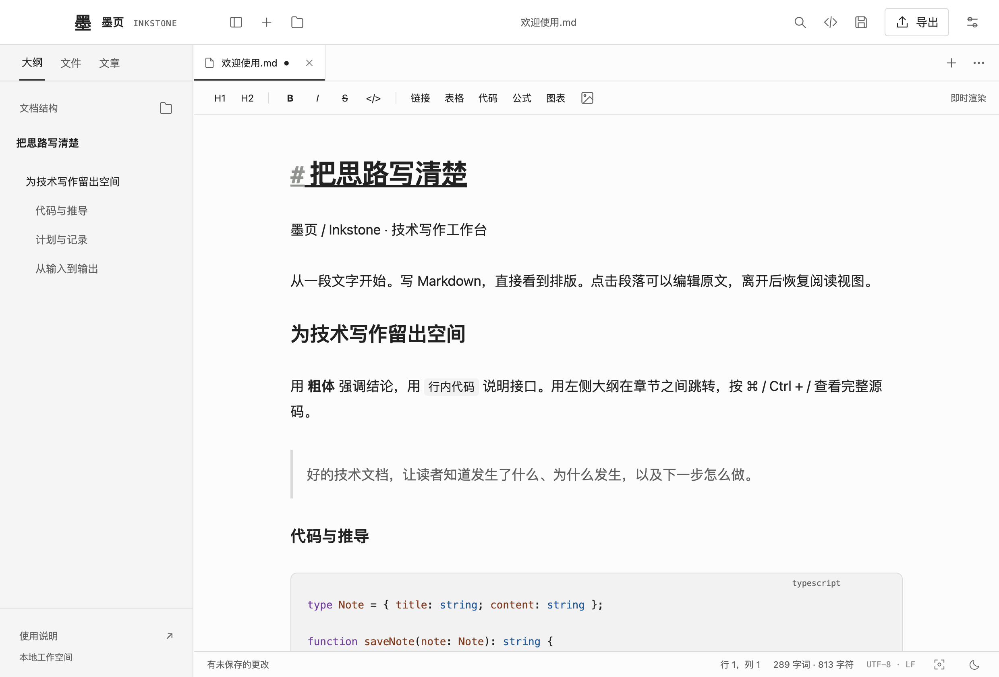

<p align="center">
  
</p>

# 墨页 / Inkstone

本地优先的 Markdown 桌面编辑器。打开文档先看到整篇排好版的阅读视图，点到哪一块，那一块就变回可编辑源码。Markdown 源码始终是唯一数据源，排版只是同一份文本的另一种显示。

适用于 macOS、Windows 和 Linux。

<p align="center">
  
</p>

## 功能

- **排版态就地编辑**：成对标记在闭合后隐藏（粗体、代码、删除线、高亮、链接、图片、行内公式），光标进入才显现淡化源码；标题、列表、任务框、引用和分隔线会在输入完成时排版。
- **整篇一致的渲染**：一次解析、逐块渲染并共享同一份解析上下文。重复标题锚点、脚注、引用式链接、`[TOC]`、YAML 属性卡片、GitHub 警示块都能跨块解析。
- **技术文档语法**：GFM 表格（就地输入、Enter 追加行、Tab 走单元格、拖动列宽）、KaTeX 公式、Mermaid 图表、代码高亮（常用语言内置，其余按需加载）。
- **文件与工作区**：文件树、文件夹全文搜索、最近文件、会话恢复、崩溃恢复、保存历史与逐行 diff、外部修改提示。
- **链接与图片**：本地 `.md` 链接支持跨文档锚点，源码中的行内链接可用 Ctrl/Cmd+点击打开。图片迁移支持标题、尖括号和引用式写法；首次保存会保全临时图片，跨目录另存或移动时会复制文档引用的本地 `assets/` 图片。
- **界面**：默认是 38px 单行标题栏和纯白纸面；偏好设置可切回带标签栏与工具栏的工作台外观。中文界面，命令面板（`Ctrl/Cmd+P`）、大纲、专注/打字机模式、自定义 CSS 主题（含 `#write` 的 Typora 主题走受限正文映射）。
- **导出**：自包含 HTML、无样式 HTML、整篇 PNG、PDF（大纲、页眉页脚、页码、纸张与页边距预设），以及复制为 Markdown/HTML。Pandoc 未安装时，对应格式会降级并提示。

## 当前进度

版本 `0.1.0`，仓库里还没有 GitHub Release，安装包也尚未签名或公证。

| 平台 | 状态 |
| --- | --- |
| macOS（Apple Silicon） | 2026-11-14 已在本机用 `Inkstone.app` 验证：打开并编辑保存 `.md`，以及设为默认应用。打包工作流会打出临时签名的 `.dmg`（见下方「打包」）。 |
| Windows 10/11 x64 | CI 单测与构建已通过；安装包、文件关联和系统输入法待实机验证。 |
| Linux（AppImage） | CI 单测与构建已通过，并已交叉打出 AppImage；桌面启动和系统关联待实机验证。 |

## 环境要求

| 项 | 要求 |
| --- | --- |
| Node.js | CI 使用 `26.x`。macOS 本机验证使用 Node.js `22.23.2` 和 npm `10.9.8` |
| 操作系统 | Windows 10/11 x64、macOS（Apple Silicon / Intel）或 Linux（AppImage） |
| Electron | 45.2.3（`devDependencies`，随 `npm ci` 安装对应平台二进制） |
| 显示环境 | `npm start` 与桌面用例都需要真实桌面会话（无头环境无法完成窗口与剪贴板断言） |

## 从源码运行

```bash
npm ci          # 按 package-lock.json 精确安装；已有 node_modules 时也可用 npm install
npm start       # 先 vite build，再启动 Electron（加载 dist/）
npm run dev     # 只启动 Vite 前端预览：vite --host 127.0.0.1，终端会打印地址
```

`npm start` 等同于 `npm run build && electron .`，每次启动都会用当前源码重新构建 `dist/`。

`npm run dev` **不是**桌面应用：它只用 `src/browser.js` 提供简化文件桥接，没有真实文件系统、原生菜单和导出能力，只适合调界面。不要把它当成打包或日常启动方式。

Electron 首次启动需要下载对应平台的二进制；下载受阻时可单独执行 `npx install-electron`。

## 打包

在对应平台的机器上执行，并加上 `--publish never`，只在本地出包、不上传。

```bash
# macOS：可运行的 .app（输出 release/mac-<arch>/Inkstone.app）
npm run build && npx electron-builder --mac dir --publish never

# macOS：临时签名的 dmg 安装盘（含安装说明和“应用程序”链接）
npm run build && npx electron-builder --mac dmg --publish never

# Windows：NSIS 安装包（输出 release/*.exe 与 release/win-unpacked/）
npm run build && npx electron-builder --win nsis --publish never

# Linux：AppImage
npm run package:linux
```

`npm run package:mac` / `package:win` 也会构建并打包，但默认没有 `--publish never`。

macOS 使用临时签名（`mac.identity` 为 `"-"`，关闭 Hardened Runtime，不做公证）。electron-builder 从内到外签名嵌套的 Mach-O、framework 和 helper；`scripts/verify-macos-ad-hoc.cjs` 在生成 dmg 之前执行 `codesign --verify --deep --strict`，不通过就停止构建。安装盘里有 `Inkstone.app`、指向“应用程序”的链接，以及 `安装前请阅读 - Read Me.txt`（正文来自 `docs/install/macOS安装说明.txt`）。第一次打开：把应用拖进“应用程序”后从那里启动；若系统拦截，右键“打开”，或到“系统设置 → 隐私与安全性 → 仍要打开”。只在信任来源时，才按说明用 `xattr` 去掉隔离标记。不必关闭 Gatekeeper 或 SIP。

Windows 安装包保持可选目录（`oneClick: false`，`allowToChangeInstallationDirectory: true`），并带上 `.md` / `.markdown` 文件关联。安装程序的许可页显示 `docs/install/windows-license.html`（与 `docs/install/Windows安装说明.txt` 同一份说明）。若弹出 SmartScreen，选择“更多信息”→“仍要运行”。新版本装到原目录会就地升级。

应用图标使用 `build/icon.png`（1024×1024，白底黑字 `IN`）。electron-builder 会据此生成各平台图标。

也可以在 GitHub Actions 里手动打包，不创建 Release。打包用的版本号来自 git tag，不需要为了出包去改 `package.json`。工作流只在运行器上把该版本写进 `package.json` 和 `package-lock.json`，不会提交或推送。

```bash
git tag -a 0.1.1 -m '...'
git push origin 0.1.1
```

然后打开 **Actions** → **package** → **Run workflow**。**Use workflow from** 里可以选择刚推送的 tag；选分支时，用该提交能追溯到的最近一个 `1.2.3` 或 `v1.2.3` 形式的 tag（前导 `v` 会去掉）。找不到符合「主.次.修订」的 tag 时工作流会失败，不会猜一个版本。如果 HEAD 不正好在这个 tag 上（tag 之后还有提交），日志里会有警告。

结束后在该次运行页面下载 Artifacts：`inkstone-<版本>-windows-x64` 含 Windows x64 的 NSIS 安装包和 `Windows安装说明.txt`，`inkstone-<版本>-macos-arm64` 含 Apple Silicon 的 `.dmg` 和 `安装前请阅读 - Read Me.txt`。产物保留 7 天，不会发布到 Releases。打开方式见各安装说明。

## 测试

| 命令 | 覆盖内容 |
| --- | --- |
| `npm test` | 22 个测试文件、**250 项**单元测试 |
| `node test/desktop.mjs` | Playwright 驱动真实 Electron，**123 个 STEP**（编辑、保存、公式与图表、IME、文件树、会话恢复等） |
| `node test/perf.mjs` | 排版态输入延迟基准（5k / 30k / 100k 字符） |
| `npm run visual` | 生成真实桌面截图，供人工视觉检查 |

RFC 0001 的独立回归：`node test/rfc0001-desktop.mjs`、`node test/rfc0001-rendering.mjs`、`node test/rfc0001-first-save.mjs`。

桌面用例依赖真实剪贴板和鼠标时序，必须在真实桌面会话里跑，因此**不在 CI 的必过流程里**。CI（`.github/workflows/ci.yml`）在 Windows、macOS、Linux 上跑 `npm test` 和 `npm run build`；桌面用例只作为手动触发的独立 job。`test/perf.mjs` 也不在 CI 中运行。更细的注意事项见 `HANDOFF.md`。

## 导出

| 格式 | 默认行为 | 可选项 / 限制 |
| --- | --- | --- |
| HTML | 自包含：主题/应用 CSS、公式字体、本地图片全部内嵌；外部图片仍保留原 URL。 | 无额外设置。 |
| HTML（无样式） | 语义正文：标题/脚注/公式锚点 ID、链接、表格、图表 SVG、本地图片 data URI 均保留；不写应用/主题样式。公式输出为单一 MathML 树。 | 仅 `.html` 文件，不发起网络请求。 |
| PNG | 在隐藏窗口中按 `devicePixelRatio` 捕获整篇正文，不含工具栏、光标或选区。默认宽度为正文宽度加左右各 48px。 | 宽度上限 8192px、高度上限 32000px、总像素上限 60,000,000；外部图片不会被下载。 |
| PDF | 打印背景、优先 CSS `@page`、生成文档大纲与 tagged PDF。 | 页眉/页脚为纯文本，支持 `${pageNo}`、`${pageCount}` / `${totalPages}`；可预设纸张、页边距、横向和页码。 |

浏览器开发预览（`npm run dev`）只有 HTML / PDF。所有导出都在本地完成，不上传图片，也不执行自定义命令。保存对话框取消时不写文件。

## 目录结构

```text
inkstone/
├── .github/workflows/
│   ├── ci.yml                 # push / PR：单测与构建；手动触发桌面用例
│   └── package.yml            # 仅手动：从 git tag 取版本，Windows x64 NSIS 与临时签名的 macOS arm64 dmg
├── build/icon.png             # 应用图标源图（1024×1024）
├── docs/install/              # 中英安装说明：macOS 放进 dmg，Windows 放进安装程序和产物
├── scripts/verify-macos-ad-hoc.cjs  # dmg 之前校验 codesign --verify --deep --strict
├── docs/assets/logo.png       # README 用圆角 logo
├── electron/                  # 主进程：窗口、菜单、存储、导出、会话、资源路径
├── src/                       # 渲染层：编辑器、排版、表格、导出与界面
├── test/                      # 单元测试、桌面 e2e、性能测试与截图脚本
├── docs/                      # 设计文档、对等基准、回归映射与历史截图
├── tokens.css                 # 主题色板
├── index.html
├── vite.config.js
├── HANDOFF.md                 # 交接记录
└── dist/                      # 构建产物（git 忽略）
```

## 安全说明

文档是不可信输入，因此**打开一个 Markdown 文件不应该让机器联系任何其他主机，也不应该执行任何东西**。所有资源路径都在主进程里统一解析（`electron/assets.cjs`）：UNC 路径、`\\?\UNC\` 与 `\\.\` 设备路径、带 host 的 `file://host/…` 在第一次文件系统调用之前就被拒绝——仅仅对这类路径调用 `realpath()` 在 Windows 上就会建立 SMB 会话并泄露用户的 NTLM 哈希。本地路径在 `realpath` 之后再检查一次，防止符号链接把请求带到网络上。图片只接受白名单扩展名，并必须是真实存在的普通文件；文档链接在扩展名属于可执行或脚本类时一律拒绝，不会交给 shell。

渲染层使用 `contextIsolation` + `sandbox`，权限请求全部拒绝，自定义 `inkstone-asset://` 协议只服务已登记的文档，HTML 经 DOMPurify 白名单清洗。自定义主题 CSS 只从本地主题目录读取，网络、UNC、绝对路径和符号链接逃逸一律拒绝。文件夹搜索的正则模式默认关闭。

## 已知限制

- 活动块由 CodeMirror 编辑 Markdown 源码，不是 typora 式的可编辑渲染 DOM。超长文档超过排版阈值（约 20 万字符）时回退为源码模式。
- 常规 Markdown 表格支持就地编辑、行列重排和调整列宽。混合原始 HTML 的表格保留源码编辑。
- 公式引擎是 KaTeX，宏支持范围与 MathJax 不同。PDF / PNG 已在 macOS 自动化中验证，Windows 实机的字体替换与打印视口仍需复测。Pandoc 未安装时，DOCX / ODT / EPUB / LaTeX / RST 只能降级提示。
- 同一应用进程的多个窗口按真实文件路径协调保存。多个进程之间仍使用磁盘版本检测，无法保证其他程序不会在检查与替换之间写入。
- macOS Apple Silicon 已验证系统拼音和本机文件关联。Windows 与 Linux 的真实系统输入法和系统文件关联待验证。
- 桌面用例对时序敏感，未纳入 CI 必过流程。
