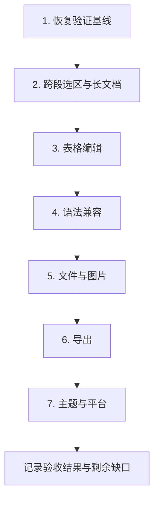

# 设计文档：墨页剩余问题收敛

- 日期：2026-11-08
- 状态：草稿

## 1. 需求理解

墨页已完成嵌套列表、引用和任务项的首批改进，本 RFC 收录剩余的体验差异与验收缺口。
先恢复验证基线，再处理跨段选区、长文档和表格，随后补齐复杂语法、文件图片、导出及主题平台支持。
延续现有编辑约定：标题换行后排版，列表和引用等到分隔空格才排版，嵌套空项按 Enter 退出一层。
假设 Markdown 源码继续作为唯一文档状态；待确认项为长文档性能门槛、公式兼容范围、图床服务和各平台实机条件。

现状以代码为准。[对照基线](../parity-baseline.md) §7.4 的「已实现」指可以跨块选取，[编辑器](../../src/editor.js) 仍会在拖选时展开经过的块，并在文档超过 20 万字符时关闭实时排版。[README](../../README.md) 关于嵌套粗斜体内层标记会露出的描述已过时，[现有用例](../../test/live-preview.test.js) 已覆盖内层标记隐藏。基线中的平台和导出记录是历史证据，不能代替本轮验收。

## 2. 接口改动

**公开 HTTP API 无。** 以下是对现有渲染接口和 Electron IPC 的设计，实际新增参数在对应批次确定。

| 接口 | 设计与兼容性 |
| --- | --- |
| 编辑器内部选区、表格及预览 | 复用 `src/editor.js` 的 CodeMirror 编辑事务和 `src/source-map.js` 的渲染位置映射。以源码位置表达选区；表格重排以现有表格模型及来源、目标索引为输入，输出一次源码事务。语法扩展沿用 `src/markdown.js` 的渲染和错误提示。 |
| `openFolderPath(folder)` | 复用 [主进程](../../electron/main.cjs) 已有 IPC。输入文档父目录，成功返回现有的 `{ path, name, entries }`。已有工作区保留；加载失败仅提示，文件仍可编辑。沿用本地目录校验和错误处理。 |
| `resolveAssetFile(reference, options)` | 扩展 [资源解析](../../electron/assets.cjs) 的可选上下文，传入本地图片根目录。继续返回经校验的文件路径。未配置时按原有文档相对路径解析。图床适配方式待确认，仅在用户主动触发且上传成功后改写引用。 |
| `exportDocument(id, format, html)` | 通过 [现有预加载桥接](../../electron/preload.cjs) 扩充图片、无样式 HTML 格式，PDF 设置通过向后兼容的可选参数传递。返回文件路径或取消时的 `null`。不支持的格式、无效设置或缺少 Pandoc 沿用现有错误回传约定。 |
| `settings(patch)`、`listThemes()` | 导出预设与可选图片设置沿用现有设置入口；主题兼容优先复用 CSS 加载器。现有设置在缺少新项时使用默认值。无新增错误码。 |

## 3. 数据库改动

无。方案沿用 Markdown 文件、现有表格列宽表示及 `settings.json`。新增设置如有需要采用可选键和默认值，无数据库迁移或回滚 DDL。

## 4. 流程图

每批由 Pi 串行实现，主控对照源码和关键交互独立审核。发现新增回归时在本批修正并复测，通过后再进入下一批。

## 5. 范围边界

**本次做，按以下顺序实施：**

1. **恢复验证基线。** 对照 [命令行路径处理](../../electron/argv.cjs)、资源解析及 `revealDocument` 调用，复现两项 macOS 路径单测和 Finder 断言。按真实平台语义修复产品逻辑或测试桩，保留路径拒绝规则。
2. **跨段选区与长文档。** 让拖选和键盘扩选共用源码选区，利用渲染位置映射保留中间块的排版，剪贴板、删除和撤销仍消费同一范围。先以 [性能脚本](../../test/perf.mjs) 记录小、中、大文档的输入和滚动基线，再减少解析与重绘；只有达到预先记录的性能门槛后才调整 20 万字符回退。
3. **表格。** 扩展 [表格模型](../../src/table.js) 的解析、序列化和列宽处理，先实现数据行和列重排，再通过 [界面入口](../../src/main.js) 保留单元格外观进行编辑。列宽和对齐跟随原列，表头与分隔行保持合法。
4. **语法。** 以语法树区分嵌套分隔线与 Setext。先用跨公式引用样例评估离线 MathJax 兼容路径，保留现有 KaTeX 能覆盖的行为。对 `sequence`、`flow` 单独解析，因为 Mermaid 无法直接消费这两种围栏；复用现有预览、错误提示和导出承接流程。
5. **文件与图片。** 无工作区时打开单文件可加载其父目录，检查 Mac 快速打开快捷键冲突。用同一资源解析规则处理图片根目录、`typora-root-url` 兼容、另存为和导出。上传适配在服务选定后实施，失败时保留本地引用。
6. **导出。** 在现有 HTML、PDF 流程上补图片、无样式 HTML、PDF 页眉页脚、页码和预设。用固定样例比较 Pandoc 原文输入与结构化输入，确认实际收益后再改转换链路。
7. **主题与平台。** 优先复用主题加载和 [样式](../../src/styles.css)，验证代表性 Typora 主题的选择器和本地资源。扩展现有打包配置支持 Linux，再验收三平台基本操作、文件关联和真实中文输入法。

**明确不做：** 像素级复刻、整套编辑器重写、账号体系、后台上传、签名公证和公开发布。

**开发原则：** 开工前同时核对文档和代码，优先复用现有接口与模块。确需新增时在对应批次说明原因。保持单一数据源和清晰职责，采用满足需求的最小实现，清除冗余字段和临时补丁。测试集中在核心路径与已知回归。

## 6. 验收标准

- [x] 两项路径用例按目标平台语义通过，[桌面回归](../../test/desktop.mjs) 能越过 Finder 用例并执行到结束。
- [x] 对含标题、列表、代码块的文档正反向拖选和键盘扩选，中间块保持排版，复制、删除和撤销使用正确源码范围。用同一设备记录 5k、30k 和超过 20 万字符档位的输入与滚动结果，按事先确定的门槛判定是否调整回退。
- [x] 一张包含转义竖线、列对齐、自定义列宽的表格可就地编辑、移动行列并撤销。公式标签与交叉引用按本批确定的兼容范围工作，三类图表可渲染，嵌套分隔线与 Setext 可区分。
- [x] 打开单文件可加载父目录且保留已选工作区，图片在另存为后仍可打开。若启用上传，失败时文档仍指向原本地文件。
- [x] 用同一份样例打开 HTML、图片、PDF、DOCX 和 EPUB 产物，核对分页、书签、公式、图表和图片。无 Pandoc 时能力提示符合现有约定。
- [ ] 记录主题兼容范围，macOS、Windows 和 Linux 各完成安装、打开、编辑、保存和文件关联。使用真实系统输入法检查组合输入、候选确认和退格。
- [x] 每批通过对应验收、相关回归和构建。标题延迟排版、空格触发及嵌套空项逐层退出通过回归。缺少实机或依赖的条目标明待验收。

**2026-11-09 本地验收。** 242 项单测、123 步 macOS 桌面回归通过。另验证原生导出、Pandoc DOCX/EPUB、代表性 Typora 主题与真实系统拼音。图床等待选定服务，Pandoc 公式交叉引用和图表保留其既有兼容范围。

Apple Silicon 的 `release/rfc-0001/mac/mac-arm64/Inkstone.app` 已实际打开、编辑、保存，并核对包内 Markdown 关联声明。Linux x64 的 `release/rfc-0001/linux/Inkstone-0.1.0.AppImage` 已交叉生成并解包验证 `text/markdown`、`.md` 和 `.markdown`。Windows 与 Linux 的实机启动、系统文件关联及真实输入法尚待验收。

## 7. 影响面

选区和表格会影响剪贴板、撤销和输入法；长文档优化须保留引用、脚注和目录的全局解析结果。公式、图表和图片根目录会同时影响预览与导出。资源加载继续由主进程校验本地路径；上传只发送用户主动选中的资源。主题兼容与 Linux 打包分别验证，防止影响现有 macOS、Windows 构建。

## 8. 回滚方案

各批次独立交付。遇到源码改写、选区丢失、输入明显退化或导出缺内容时，按变更边界撤回对应批次，保留派发前已有改动。恢复原选区装饰及长文档源码回退作为编辑降级；关闭新导出格式或兼容选项即可恢复原渲染与导出路径。

无数据库回滚。用户 Markdown、图片和导出文件保留；旧版忽略未识别的可选设置。需要回退已写入的文档编辑时，使用编辑器撤销或用户选择的文件历史版本。
