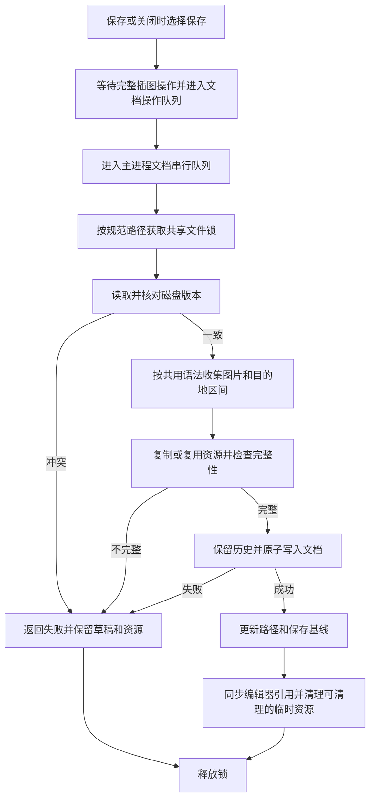
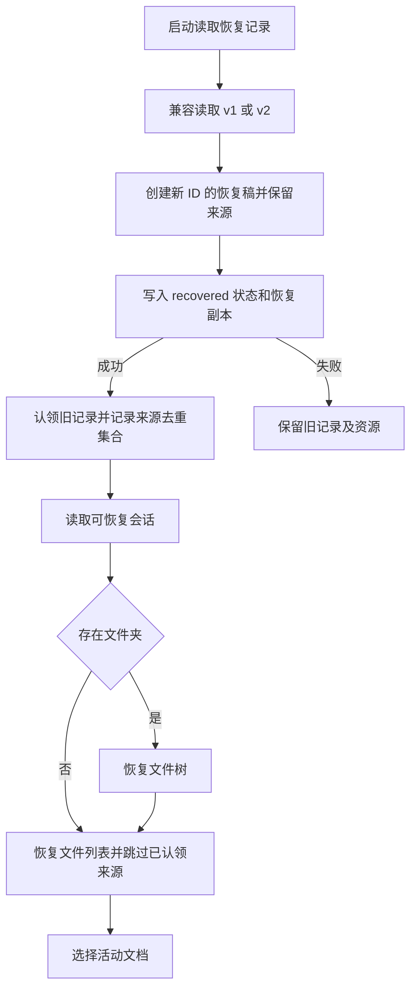
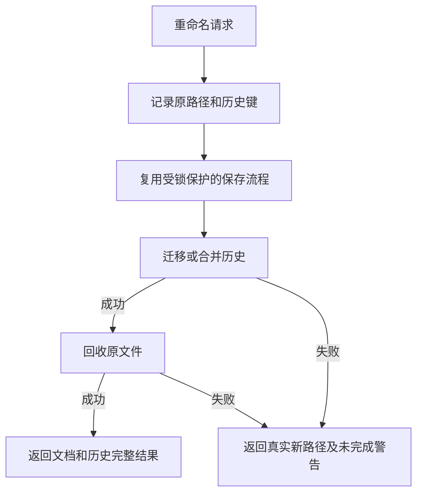

# 设计文档：项目审查九项问题修复

- 日期：2026-11-13
- 状态：草稿
- 项目：墨页 / Inkstone
- 调研基线：`e47985b8aa8a7bb370c54d18372bfe63bec7167c`
- 授权范围：本次只编写设计文档，尚未实施以下修复。

## 1. 需求理解

针对本次项目审查发现的九项问题，修复保存、图片迁移、恢复、历史、导航和渲染的一致性。
首先保证同一应用的多个窗口不能静默覆盖彼此的修改，图片没有完整迁移前不能清除原临时资源。
恢复稿继续作为需要另存为的新文档，但必须保留资源来源和未保存状态，包括空正文。
沿用 Electron、CodeMirror、Markdown 源码作为唯一数据源的架构，在现有模块上完成修复。
成功标准是第 6 节各项真实文件、真实 Electron 验收成立；当前基线测试通过不代表这些修复已完成。

### 问题与基线证据

以下结果来自本会话在上述提交上的实际检查与复现，是缺陷基线，不是修复验收结果。

| 编号 | 优先级 | 问题及实际证据 | 当前代码位置 |
| --- | --- | --- | --- |
| R1 | P1 | 两个真实窗口同时保存同一个文件，两次均返回 `ok=true`、`dirty=false`，磁盘仅保留一份修改；独立 Store 的文件系统复现也出现 5/5 次双成功 | `electron/store.cjs:58,126–154`；`electron/main.cjs:createWindow` |
| R2 | P1 | 普通图片引用迁移 1 个文件；带标题、尖括号、引用式写法均迁移 0 个。首次保存成功后仍无条件删除临时资源目录，因此存在丢图风险；删除后果由调用链确认，未把模块复现冒称为完整保存对话框验收 | `electron/store.cjs:377–444`；`electron/main.cjs:880–907,908–936` |
| R3 | P2 | 已保存文档的草稿恢复后 `path=null`，原图片仍存在但相对路径解析报 `ENOENT`；空正文恢复后 `dirty=false`，恢复目录不再有记录 | `electron/store.cjs:324–360`；`electron/main.cjs:assetOptions`；`src/main.js:addDocument` |
| R4 | P2 | 会话文件已记录单独打开的文件，未打开文件夹时重启仍回到欢迎页 | `electron/main.cjs:657–668`；`electron/session.cjs:restorableSession` |
| R5 | P2 | 最近文件对话框打开文件报“该文件不在已打开的文件夹中”，同一文件通过原生最近文件入口可打开 | `src/main.js:793–798`；`electron/main.cjs:chooseOpen,openPath` |
| R6 | P2 | 真实文件重命名成功后，历史列表数量从 1 变为 0；旧历史未按新路径键迁移 | `electron/main.cjs:615–625,renameEntry`；`electron/store.cjs:historyKey,moveHistory` |
| R7 | P2 | 修改第 3099 行后，`diffLines` 只返回前 3000 行，变更数为 0 | `src/diff.js:9–14`；`src/main.js:compare-history` |
| R8 | P2 | 同一本地链接在阅读态可以打开，源码中的 Ctrl+点击无反应 | `src/main.js:492–504`；`src/editor.js:903,1031–1042` |
| R9 | P3 | 将第二个标题改为与第一个相同后，两个实际 DOM 标题 ID 均为 `same`，而不是 `same`、`same-1` | `src/markdown.js:171–180,421–464,477–513` |

本轮已运行构建和 100 项真实文件系统/纯函数检查，均通过。未运行含原生对话框替身的完整 `test/desktop.mjs`，而是用独立临时用户目录和真实 IPC 复现关键流程。临时探针不是仓库稳定验收入口，实施时应将核心场景纳入仓库中的无 mock 检查。

### 关键假设与设计取舍

- 默认修复全部 R1–R9；本文件不代表用户已授权实施、提交、推送或打包发布。
- R1 的并发保证限定为一个 Electron 主进程内、基于磁盘版本打开的同一路径文档。保留现有外部修改检测；不声称进程内锁能排除其他应用恰好在检查和替换之间写入。
- R2 的常规跨目录另存为仍迁移文档引用的本地 `assets/` 图片，支持行内、带标题/尖括号、引用式图片及其定义。首次保存另加第 2.3 节的临时目录保全规则。任意目录重组、远程图片下载、HTML/SVG/CSS 语法中的目的地改写不属于本次扩展。
- 恢复稿保持 `path=null`，必须选择保存位置；新增的来源路径只用于资源解析和去重，不能作为默认覆盖原文件的授权。
- 对超预算 diff 复用现有按行位置比较的降级算法，保证覆盖完整输入；允许其不是最小编辑序列，并在界面说明比较模式。
- 选择局部修复及必要的纯解析工具提取。关闭多窗口、取消资源迁移会损失现有功能；引入数据库、独立文件服务或更换编辑器不符合当前修复目标。
- 无阻塞性待确认项。macOS 的真实行为、打包依赖闭包及实际包体变化属于实施阶段验证事项，本文不将其视为已通过。

### 文档与代码差异

来源已通过只读 `git log`、`git blame` 和 `git show --unified=0` 核对。下列提交的英文前缀是原有历史，不作为以后提交说明的格式。

- **S1**：`e47985b8aa8a7bb370c54d18372bfe63bec7167c`，作者 `ziggy`，日期 `2026-11-07T23:17:49+08:00`，摘要 `fix: 全项目审计修复（第 1～6 批）`。
- **S0**：`3ba09bef7f2f52f3a14d118fd568b14f5b18330e`，作者 `shenziggy0`，日期 `2026-11-07T10:49:43+08:00`，摘要 `feat: 墨页 Inkstone 0.1.0 首次提交`。

| 差异 | 文档位置与说法 | 代码现状 | 来源提交及经 diff 核实的改动 | 类型 |
| --- | --- | --- | --- | --- |
| D1：图片迁移覆盖不足 | `README.md:11`“链接与图片”声明另存为/重命名同步 `assets/`；`docs/regression-map.md:72` 的 4.7 将首次保存临时图片迁移标为完成 | `store.cjs:385` 只匹配无标题的紧凑行内写法；`main.cjs:901` 在保存成功后清理整个临时目录 | S1 新增这两段说明，并扩展 `syncAssets` 接收临时源目录；S0 已加入目前仍使用的图片正则，S1 没有补齐其语法覆盖 | 类型待确认：完成式说明加入时即存在覆盖缺口，不能认定为后续代码变更造成的文档过期，也不是明确的待实施设计 |
| D2：文件重命名的历史迁移 | `docs/regression-map.md:101` 的 6A.7 声明文件树重命名同时修改标签和历史目录 | `main.cjs:moveDocumentFile` 调用 `store.save` 后回收原文件，没有迁移历史键；目录重命名走 `rekey` 才会调用 `moveHistory` | S1 同时新增 6A.7 和 `moveDocumentFile`，其新增 diff 明确只有保存、回收及近期记录操作 | 类型待确认：同批提交的完成式描述超过实际实现覆盖 |
| D3：缓存失效及锚点 | `README.md:8` 声明共享整篇上下文处理重复标题；`docs/regression-map.md:39` 的 2.2 声明标题变化通过全局签名使全部块失效 | `globalSignature` 明确不包含标题，改由 `prepareDocument` 给块分配 context；`renderGroups` 命中缓存跳过渲染，导致 `heading_open` 中的 `env.slugs` 计数未推进 | S1 新增上述文档，也新增“不将标题放入全局签名”的注释、逐块 context 和缓存命中分支 | 类型待确认：同批提交中说明与实现不一致，且锚点仍有运行时缺陷；不能用“恢复全量渲染”代替修复 |
| D4：独立文件会话恢复 | `README.md:10` 和 `docs/regression-map.md:99` 的 6A.5 列出会话恢复；`electron/session.cjs:restorableSession` 的接口注释明确支持没有文件夹的文档 | `restorableSession` 会返回这些文件，但 `main.cjs:659–667` 把实际打开文件的循环放在 `if (session.folder)` 内 | S1 新增上述完成记录、接口注释和有条件的启动恢复代码 | 类型待确认：同批引入的接口契约与调用方不一致；已有桌面覆盖只证明了有文件夹的场景 |

实施后应按实际验收结果同步上述功能说明和回归映射。未完成的验收不得继续仅用原来的“✅”概括新增覆盖范围。

## 2. 接口改动

### 2.1 现有契约与复用范围

本项目没有 HTTP 服务接口。桌面接口由 `electron/preload.cjs` 转发到 `electron/main.cjs:handle` 注册的 `inkstone:<方法名>` IPC，调用方在 `src/main.js:api` 解包。

继续使用 `{ ok: true, value }` / `{ ok: false, error: 中文消息 }`；本次不新增错误码体系，不废弃现有 IPC 方法。所有路径校验继续复用 `resolveLocalTarget`、`pathInsideRoot`、`resolveAssetFile` 和现有图片类型限制。

| 路径 / 方法 | 入参 | 出参与错误行为 | 兼容性与改动 |
| --- | --- | --- | --- |
| `inkstone:saveDocument` | 保持 `(id, saveAs=false)` | 现有文档结果及 `rewritten`；版本冲突或迁移不完整返回现有失败信封，文档保持未保存 | 不要求调用方传入任意资源目录；迁移与保存使用主进程持有的文档状态 |
| `inkstone:closeDocument` | 保持 `(id)` | 仍返回 boolean 或失败信封 | 选择“保存”时复用完整保存流程；失败/取消不能关闭文档或清理图片 |
| `inkstone:insertImage` | 保持 `(id,payload)` | 仍返回资源相对路径或失败信封 | 字节写入按文档串行，选择资源目录时读取最新状态；渲染层负责把正文回填与 flush 包含在同一个完整操作内 |
| `inkstone:renameDocument` / `renameEntry` | 保持 `(id)` / `(target,name)` | 保留原文档结果；允许附加 `warnings: string[]` 表达新文件已写入、但历史迁移或旧文件回收未完成 | 两个渲染层入口都应应用返回的真实路径并展示警告，不能只显示“已重命名” |
| `inkstone:bootstrap` / `newDocument` / `updateDocument` / `saveDocument` | 原入参不变 | 文档记录增加可选 `recovered: boolean`，旧记录缺省 false | `recovered` 表示恢复稿尚未成功保存；不把来源路径暴露成可写的当前路径 |
| `inkstone:openPath` | 保持 `(file)` | 原文档结果；继续执行本地路径检查 | 命令面板、最近文件对话框改为复用它；文件树继续走受工作区限制的 `openDocument` |
| `inkstone:finishQuit` | 保持无参 | 仍返回原成功信封；内部允许异步等待现有 WorkspaceState 落盘 | 在窗口实际关闭前完成会话写入，不依赖 window-all-closed 之后的异步工作 |
| `createEditor`，`src/editor.js` | 现有末参 `onNavigate` | 无返回结构变化 | `src/main.js:addDocument` 补传 `navigateLink`，沿用现有本地链接/锚点/外链分类 |
| `diffLines` / `diffHTML`，`src/diff.js` | 保持两个文本参数 | `diffLines` 保持行记录数组；`diffHTML` 在降级时增加中文模式说明 | 不新增 IPC；通过模块内部共用比较结果避免计算两次 |

`recovered`、`warnings` 是本 RFC **拟新增**字段；不声称当前代码已经支持。`sourcePath` 见第 3 节，仅由主进程设置和维护。

### 2.2 R1：按真实路径串行保存

- 保留 `DocumentStore.serial(id, action)` 对同一文档的更新顺序；在 `electron/store.cjs` 增加模块级共享的文件任务队列。现有实例内 `locks` 无法协调不同窗口，因此不能直接复用其作用域。
- 路径键复用现有 realpath 归一化：已存在文件用真实路径，新文件用真实父目录加文件名，Windows 的锁键统一大小写。
- 固定顺序为“文档队列 → 文件路径队列”。正常保存锁目标路径；移动需要锁源、目标两个路径，去重排序后获取，避免反向移动互相等待。
- 在锁内重新读取并校验磁盘版本，再保留历史、执行 `atomicWrite`、更新 `savedContent/version/dirty` 和恢复记录。不能在加锁前读取版本再在锁内直接写入。
- 两个窗口从同一版本编辑并同时保存时，只允许先获得锁的一方写入；另一方必须收到现有冲突错误，保留其文本和恢复副本。路径任务完成后移除空队列。
- 资源迁移与文档提交纳入同一文档保存任务，避免迁移依据旧内容、提交却使用另一份新内容。拆出 Store 内部“不再自行加锁”的保存步骤供编排复用，禁止在已持有文档队列时再次调用会加同一把锁的公开方法。

**跨 IPC 的完整操作顺序：** 在渲染层为每份文档增加一个内存 Promise 队列，统一编排保存、图片插入、关闭及已打开文档的重命名/移动。它协调跨 IPC 的操作顺序，主进程的文档队列和文件锁仍负责文件一致性，两者职责不同。现有 `doc.saving` 只作界面状态，不能承担互斥保证；普通正文输入仍可继续。

- 一次图片插入任务必须覆盖“读取所选图片 → 调用真实 insertImage → 将返回引用写入该文档编辑器 → await flush”，全部完成后才释放渲染层队列。任务开始与结束都针对最初捕获的文档 ID，不因切换标签改写其他文档；文档已关闭的后续排队任务直接取消。
- 插图先开始，保存就等待引用已经回填并 flush 后再取保存内容；保存先开始，插图就等待保存回包已更新文档路径后再调用 insertImage，由主进程按新的资源基准写入。保存取消/失败后，排队的插图按仍有效的旧基准继续，不提前清理资源。
- 主进程 `insertImage` 的资源目录选择和字节写入也进入同一文档队列，防止直接 IPC 与保存交错；但不能把这把主进程锁当作渲染层完整操作队列的替代。
- 队列入口与内部步骤分开：队列内调用保存/flush 的内部实现，不能等待重新排到自己后面的任务。关闭时选择保存和自动保存复用同一约束；队列完成后释放引用，不写入恢复 JSON。

### 2.3 R2：按解析结果迁移并精确改写图片引用

**现有能力复用：** `syncAssets` 的字节比较、同名不同内容的选名策略，`resolveAssetFile` 的路径限制，`src/main.js:applyAssetRewrites` 的实时编辑器回写入口都保留。替换其中的单一正则和全局字符串替换。

**必要提取：** 拟新增 `electron/markdown-parser.mjs` 和 `electron/asset-references.mjs` 两个无 DOM 模块。前者从 `src/markdown.js` 提取解析器构造及影响图片语法的既有插件、front matter 规则；后者收集图片及引用定义的目的地区间，并按映射生成文本编辑。阅读渲染器和主进程共享这套语法配置，主进程通过缓存的动态 import 使用它。`src/markdown.js` 保留 DOMPurify、HTML 最终加工、Mermaid 和渲染规则，不能把整个含 DOM 的渲染模块直接引入主进程。

- 复用已安装的 `markdown-it` 及其 `image/reference` 解析规则、目的地解析辅助函数；为实际解析成功的图片记录目的地区间。当前 token 的 `map` 主要是行范围，不能直接当作字符偏移；通过最小规则封装补齐字符位置，不复制整套解析器。
- 覆盖 ``、``、``、完整/折叠/简写引用式图片。引用式修改对应定义；一个定义同时被普通链接和图片使用时，两者继续指向同一资源。
- 不修改代码围栏、行内代码、未解析成图片的文字、其他同名普通链接。保留图片标题、alt、BOM、换行和无关文本；主进程编辑坐标对应原始字符串，渲染层编辑坐标对应 CodeMirror 的 LF 文本，显式转换，不能混用。
- `syncAssets` 保留 `{copied, skipped, renamed, content}`，拟增加 `unresolved` 以说明哪些应迁移资源未能完成。现有 `renamed: [{from,to}]` 映射继续可用；`applyAssetRewrites` 改为重新解析当前编辑器文本后只改实际目的地，因此不会覆盖保存等待期间用户追加的正文。
- 使用来源字节校验目标文件确实已复制或已有相同内容；同名不同内容按现有选名策略改写目的地。目标图片创建采用不覆盖既有文件的写入方式，若创建时被其他保存抢占，重新比较/选名。
- 把 `saveDocument`、`closeDocument` 的“保存”和 `moveDocumentFile` 中重复的资源准备收敛到同一个保存流程。应迁移资源缺失或复制失败时，中止这次跨目录保存，保留原文档、修改状态、恢复副本和临时资源；已经写出的新资源可保留，不能因回滚误删其他文档使用的文件。
- 首次保存时，该文档私有临时 `assets/` 目录中的所有图片都要得到保全，包括未被本轮图片解析器识别的引用或已不再引用的图片：无冲突时按原名复制，同字节目标可复用；已识别引用的同名冲突按解析范围改写。无法确认引用的文件遇到同名不同字节冲突时中止本次保存并说明文件名，不擅自改名后留下断链。这样可能多复制少量不用的图片，但不需要永久留置目录或新增清理登记表。
- 只有文档写入成功、全部私有临时图片均已保全，才清理临时目录；若临时目录出现本流程无法处理的文件，也必须先报错并保留，不能宣称完整。保全失败仍保留原恢复记录，已有启动清理器因此不会把它当作无主资源。用户明确选择“不保存并关闭”的丢弃语义保持不变。

**打包约束：** 当前 `package.json:build.files` 明确排除 `node_modules/**/*`，主进程目前基本只依赖 Node/Electron 内置模块。上述提取会让主进程使用现有生产依赖，实施时必须取消这一全面排除，交给 electron-builder 的生产依赖收集规则处理；不复制第三方源码、不新增解析器依赖、不新增打包服务。先保证依赖完整，包体增加记录在第 7 节；裁剪依赖不是本 RFC 的独立优化任务。完整安装包发布不属于本次授权。

### 2.4 R3：恢复稿保留来源，空正文也保持未保存

- `recoverAll` 仍创建新的文档 ID 和 `path=null`，复用 `carryUnsavedAssets` 接续原未命名文档的临时图片。为认领过程最小增加“先复制”选项：资源先复制到新 ID，新恢复 JSON 落盘后才删除旧记录和不再被活跃文档引用的旧资源；不能沿用提前 rename 后才写 JSON 的顺序，否则失败时旧记录会失去图片。
- 从旧记录的 `path` 或新记录的 `sourcePath` 恢复来源；`assetOptions`、图片插入、剪贴板图片、HTML 导出、本地链接解析和保存迁移统一使用“当前路径，否则恢复来源”的有效资源基准。
- 恢复自已保存文件的文档，继续在原文档目录解析和插入相对资源，直到成功另存为；这不会覆盖原 Markdown 文件。原目录不可写时图片插入按现有方式报错，不能偷偷写到另一目录导致显示与保存基准不一致。恢复自未命名文档则继续使用按新 ID 接续的临时目录。
- 恢复稿设置 `recovered=true`，无论正文是否为空均为 dirty。Store 与渲染层均采用 `dirty = recovered || content !== savedContent`；所有初始化、编辑、flush、路径更新和保存回包应用处一致处理，不能只在 `recoverAll` 中改一次。
- 成功保存后清除 `recovered/sourcePath`，更新保存基线；失败、取消和无改动 flush 都不得清除。新恢复记录落盘成功之后才删除旧记录；如果新记录写入失败，保留旧记录及其资源，不返回一份看似恢复成功的文档。
- `recoveredPaths` 使用来源路径防止会话恢复重复打开原文档；来源仍只表示资源与去重信息。

### 2.5 R4、R5、R8：统一会话和导航入口

- `bootstrap` 中仅把文件夹设置和文件树扫描放在 `session.folder` 分支；遍历 `session.files`、跳过已认领恢复稿、选择 active 文档在该分支外执行。缺失文件仍由现有 `WorkspaceState.restorableSession` 过滤。
- 为满足“退出再启动”的完整验收，正常退出开始时先提交包含全部文件及活动文件的会话快照，并暂停本窗口后续 `closeDocument → activate → saveSession` 的快照覆盖。`finishQuit` 在关闭窗口前等待 `WorkspaceState.flush`，不能指望最后一个窗口关闭之后再完成异步落盘。取消退出时解除暂停并保存当时实际仍打开的文档；普通手动关闭标签仍正常更新会话。不扩展为多窗口会话聚合。
- `runQuickItem` 的路径分支复用 `openPath`；已打开文档继续按 ID 切换，文件树仍保留工作区限制，不放宽 `chooseOpen` 的边界检查。
- `addDocument` 给现有 `createEditor` 末参传入 `href => navigateLink(href)`，复用错误提示。阅读态、活跃块及源码态共用同一导航结果；外链继续需要原有修饰键。
- 本轮不扩展 `linkAt` 的语法范围，修复它已经能识别的行内链接/自动链接回调缺失；引用式链接的源码态识别不作为新增目标。

### 2.6 R6：重命名时迁移历史键

- 两个重命名入口继续复用 `moveDocumentFile`；保存改变 `doc.path` 前记录 `historyKey`，完成新文件保存后计算新键并复用 `moveHistory`，不从修改后的对象反推旧路径。
- 文件树里未打开但已有历史的文件也属于本次覆盖。单文件重命名先记录旧/新路径键；目录重命名先收集目录内实际文件的路径映射，再迁移相应历史。不能只处理当前窗口打开的文档，也不能把有深度/5000 条截断的 `listMarkdown` 展示结果当作完整迁移清单；直接异步遍历实际普通文件，跳过符号链接对象，不跟随链接迁移外部目标的历史。当前已打开文档仍复用 `rekey` 更新身份，其他文件复用同一个历史键算法和 `moveHistory`。
- `moveHistory` 当前遇到目标目录已存在或 I/O 错误仅返回 false。最小扩展为明确区分“无历史可迁移”“完成”“失败”；目标历史已存在时按已有时间戳/UUID 文件名无覆盖合并，相同名字相同字节去重，不同字节重新生成合法条目名。沿用原有 50 条保留上限，成功合并后再修剪，不能先清除来源目录。
- 历史迁移成功后才回收原 Markdown 文件。失败时保留来源文件/历史，并返回新文件的实际文档状态及 `warnings`，让渲染层同步路径并说明操作未完整完成；旧文件回收失败同样处理，不能抛一个与已经发生的落盘状态不一致的普通错误。
- 上述“保留原文件”适用于先复制保存再回收的已打开文档移动。未打开文件或目录已经通过 `fs.rename` 移到新路径后，历史失败时保留来源历史，返回实际新路径及顶层 `warnings`，不虚构旧正文路径仍存在；正文至少在新路径可访问。目录内某份历史失败不能阻断其他已打开文档的路径更新。
- 普通“另存为”保留原文档及原历史，不迁移旧历史；只有重命名/移动迁移历史。目录重命名继续复用 `rekey`，共享增强后的历史迁移实现。

### 2.7 R7：完整输入上的有界 diff

- 取消 `diffLines` 对输入的 `.slice(0, MAX_LINES)`，先按现有规则切分完整文本。
- 当完整输入超过 `MAX_LINES` 或 `MAX_CELLS` 的精确比较预算时，复用现有线性按位置比较，遍历所有行；预算只决定算法，不决定哪些内容算存在。
- `diffLines` 继续返回完整行记录。`diffHTML` 为降级结果显示“按行位置比较，已覆盖全文，结果可能不是最小差异”；不使用“无修改”掩盖未比较的尾部。
- 结果 DOM 超过现有 3000 行展示预算时，按批次追加显示，并显示已展示/总记录数以及“继续显示”；比较结果本身不得截断。`src/main.js:compare-history` 只负责这个历史对话框的批次状态，不另建通用虚拟列表框架。

### 2.8 R9：标题 ID 在完整解析阶段确定

- 复用 `headingsFromTokens` 的标题顺序和去重规则，在进入 `renderGroups` 前为每个 `heading_open` token 确定 ID。
- `prepareDocument` 的标题 context 继续用于缓存键；`heading_open` 只读取预先确定的 ID，不在渲染阶段依赖“之前有多少块实际执行过 renderer”。
- 整篇 `renderMarkdown`、逐块 `renderDocument`、大纲和 TOC 共享同一 ID 分配入口，覆盖首次解析及后续编辑；继续保留未改段落的缓存复用。

## 3. 数据库改动

**无数据库、表、索引或 DDL 改动。** 项目用本地 Markdown 文件和 JSON 保存状态，因此没有迁移 SQL 或回滚 DDL。以下是必须兼容的本地数据格式变化。

| 对象 | 当前格式 | 拟变更及迁移 |
| --- | --- | --- |
| 恢复记录 `<userData>/recovery/**/<id>.json` | `{id,path,name,content,dirty,updatedAt}` | 增加 `schemaVersion:2`、`sourcePath:string\|null`、`recovered:boolean`。普通未保存修改仍保留当前 `path`；恢复成新稿后 `path=null`、`sourcePath` 保存来源、`recovered=true` |
| 旧恢复记录 | 没有 schemaVersion 和新字段 | 按 v1 读取；来源取 `record.path`，已认领的草稿显式标记 recovered，不从正文非空推断 dirty。保留旧字段，按次读取升级，不批量重写用户历史 |
| 临时图片 | `<userData>/unsaved-assets/<id>/assets/…` | 目录结构不变；复用原有跨 ID 接续；确认迁移完整前不得清理 |
| 保存历史 | `<userData>/history/<path hash>/<timestamp>-<uuid>-<name>` | 文件格式、键算法、50 条上限不变；重命名时迁移/合并，避免旧路径键失联 |
| `session.json`、`recent.json`、`settings.json` | 现有 WorkspaceState/偏好格式 | 无格式改动；修正调用顺序与路由即可 |

不向恢复 JSON 再写一份完整 `savedContent`，避免大文档恢复数据翻倍；恢复稿需要另存为的状态由 recovered 明确表达。v2 记录包含旧版能读取的正文，但旧版忽略来源和标记，因此不宣称降级后仍具有完整恢复语义，具体回滚见第 8 节。

## 4. 流程图

## 5. 范围边界

- **本次做：** 编写本 RFC；后续实施范围为 R1–R9、必要的共享解析模块、恢复记录兼容、历史对话框展示、生产依赖打包配置，以及对应功能文档/回归映射更新。
- **明确不做：** 当前不实施产品代码；不修改 swclaw；不提交、不推送、不发布安装包；不改 UI 风格、不更换编辑器、不引入数据库；不定义跨进程文件锁、跨窗口全部状态同步或任意资源目录自动搬家；不新增计费服务。

后续开发必须遵守：

1. **优先复用：** 编码前检索现有接口、模型和函数。能复用就复用或最小扩展；新增共享队列和纯解析模块的原因已在第 2 节列明，不另起平行保存/解析实现。
2. **保持整洁：** 保存、关闭保存、移动的共同步骤只保留一处；新字段有明确生命周期，统一命名和失败语义，不保留临时分支、死代码或重复文本改写器。
3. **架构清晰：** 主进程持有文件写入权，渲染层负责交互与编辑器状态；不为本次缺陷增加服务层、插件系统或假想扩展点。
4. **测试克制：** 用少量有区分力的真实场景证明核心行为，复用夹具覆盖多种图片写法，不堆砌与修复无关的异常断言。禁止 mock 文件系统、IPC、计费结果或原生对话框作为验收证据。
5. **调研有据：** 文档说明以实际代码及新验收证据为准；实施中若基线变动，先检查相关模块与提交，不把本次行号当作永久位置。以后所有提交说明、推送说明、PR 标题和摘要使用中文。

建议实施顺序为：R1 共享写入协调 → R2/R3 保存与资源恢复 → R6 历史迁移 → R4/R5/R8 会话导航 → R7/R9 对比与渲染。每组完成后通过对应核心验收，再进入下一组。

## 6. 验收标准

以下均为**待实施后的验收条件**，不表示已执行或通过。采用临时工作目录、隔离用户目录、真实文件与真实 Electron。项目没有外部模型或支付调用，真实计费测试不适用；不得为此伪造账单或引入无关收费链路。

- [ ] **R1：** 两个真实窗口从同一版本打开一份文件，各自修改并同时保存；只允许一方成功，另一方保留文本、dirty 与可读取恢复副本。随后按现有冲突流程选择处理，能再次正常保存。
- [ ] **R2：** 一个真实文档同时包含普通、带标题、尖括号、引用式图片和同内容代码示例；首次保存、跨目录另存为以及关闭时选择保存均保留可显示图片，代码示例、标题、BOM/换行及无关正文不被改写。目标目录预置同名不同内容图片后，双方图片均保留且新引用正确。
- [ ] **R2 操作交错：** 对同一未命名文档，分别先触发真实粘贴图片再触发首次保存、先触发首次保存再粘贴图片；两项操作完成并再次 flush/保存后，新图仍可显示，正文引用对应实际文件，不能仅以 IPC 返回成功认定通过。
- [ ] **R2 失败路径：** 在同一夹具中移除一张应迁移的源图片，跨目录保存必须明确失败，编辑器文本、恢复记录和其他临时图片仍在；修复图片后重试成功。不能只检查 Markdown 文件存在。
- [ ] **R3：** 已保存文件带相对图片并有未保存修改，异常退出后恢复为需另存为的草稿；图片可显示，再次另存为后仍可显示，原 Markdown 未被覆盖。另一个正文被清空的草稿，恢复及无修改 flush 后仍提示未保存，关闭须走保存/丢弃选择。
- [ ] **R3 兼容：** 同一恢复夹具包含 v1 已命名记录、v1 未命名图片草稿及 v2 再次恢复记录；均能接续资源和认领记录，未成功写出新恢复副本前不能删除旧记录。
- [ ] **R4：** 不打开文件夹，只打开两个已保存文件，退出再启动仍恢复这两个文件及活动文件；有文件夹的原场景继续成立，恢复稿优先且不会重复打开其来源。
- [ ] **R5、R8：** 对同一真实本地 Markdown 文件，最近文件对话框、命令面板、原生最近文件菜单能得到相同结果，包括无工作区/工作区外文件；同一行内链接在阅读态及源码态 Ctrl/Cmd+点击均能打开，并正确定位锚点。
- [ ] **R6：** 生成两条历史后，分别通过文件树和文档菜单重命名，旧版本仍可读取和恢复；关闭文档后从文件树重命名、包含未打开文件的目录重命名也保留历史。目标已有历史时不覆盖字节；历史迁移失败时正文仍可访问、来源历史不删除，界面路径与实际文件一致且明确显示未完成警告。
- [ ] **R7：** 修改超过 3000 行文档的第 3099 行，比较结果包含该差异；超过精确预算时显示降级模式并覆盖全文；分批展示能到达最后一条记录，不把未展示内容误报成没有差异。
- [ ] **R9：** 在先前已有缓存的文档中新增/改名/删除重复标题，得到唯一且稳定的 `same`、`same-1` 等 ID；阅读 DOM、大纲、TOC 与整篇导出一致，未改段落继续复用缓存。
- [ ] **交付检查：** 构建和相关无 mock 检查通过；真实 Electron 保存与重启回归通过。核对打包配置收集了主进程所需生产依赖，并在后续获授权的目录产物验证中确认无需开发目录的 `node_modules` 也能完成图片保存。未做发行包验证时明确标注，不写成安装包可发布。

可复用的验证位置：`test/store.test.js`、`test/assets.test.js`、`test/session.test.js`、`test/links.test.js`、`test/workbench.test.js`、`test/render-cache.test.js`；真实桌面用例补入 `test/`。现有 `test/desktop.mjs` / `test/perf.mjs` 包含对话框替换，应复用其业务场景而非将替身执行结果当作本 RFC 的真实端到端验收。需要保存对话框的场景使用真实系统对话框操作；核心存储复现可直接调用真实 Store/IPC。

## 7. 影响面

| 模块 | 影响及边界 |
| --- | --- |
| `electron/store.cjs` | 共享写入协调、恢复格式、图片迁移和历史迁移；最先落地并验证数据安全，不改变 Markdown 文件格式 |
| `electron/main.cjs` | 保存/关闭/移动的统一编排，恢复资源上下文、会话条件和部分完成结果；路径权限继续由主进程校验 |
| `electron/preload.cjs` | 方法列表原则上无须增加；仅传递兼容扩展的返回字段 |
| 拟新增纯解析模块及 `src/markdown.js` | 复用现有语法配置，提取时必须保证公式、front matter、代码块、引用定义等原有解析行为不变；标题 ID 前置分配 |
| `src/main.js`、`src/editor.js` | recovered 生命周期、精确图片改写、导航回调、最近文件路由及历史比较分批展示 |
| `src/diff.js` | 大文件比较不再丢尾部；降级算法为线性遍历，输出量随全文增长，以分批 DOM 展示限制界面成本；不承诺未实测的性能提升 |
| `package.json`、锁文件与产物 | 使用已有锁定依赖，不新增第三方解析库；调整生产依赖打包收集会增加包体，实际大小待测。无依赖版本变化时不应无故改动锁文件 |
| `README.md`、`docs/regression-map.md`、相关测试 | 依据实际结果更新 D1–D4 的说明及覆盖范围；保留 macOS、真实系统 IME、发行签名等既有未验收边界 |

性能上，不同路径保存仍可并发；只有同一路径及一次移动涉及的路径互斥。图片语法解析放在保存/迁移路径，不为每次按键新增文件 I/O。安全上不放宽网络路径、可执行链接、资源类型或 IPC 调用来源检查，也不因纯解析器提取而绕过现有渲染清洗。

## 8. 回滚方案

- **当前文档阶段：** 产品代码和用户数据均未改动。若不采用此设计，只需调整或移除本 RFC；不得清理此前真实审查产生的用户内容。
- **实施准备：** 将数据安全、会话导航、diff/渲染分组提交，中文说明；升级前保留用户目录中的恢复记录、临时资源、历史及会话 JSON 快照，记录当时实际版本。本文基线是调研依据，不是允许覆盖用户工作区的回滚命令。
- **代码回滚：** 根据实际实施提交逐组 revert，恢复对应包配置和锁文件；重新构建并验证。共享解析模块与生产依赖配置必须一起回滚，不能只撤销打包依赖导致启动时模块缺失。没有专门设计运行时回滚开关。
- **恢复数据回滚：** v2 保留旧版能读取的正文，但旧版无法理解 recovered/sourcePath。切回旧版前，先在新版将待恢复稿保存到新的、不会覆盖已有文件的位置，校验其图片；同时保留原恢复 JSON 和资源目录。不得把“旧版能读 JSON”当作完整回滚保证。
- **历史与文件回滚：** 成功重命名后的新文件、新路径历史、迁移图片仍属于用户数据，代码回滚不得反向批量移动或删除。按预先快照与操作记录恢复所需历史，保持新旧副本可访问；原文件进了回收站时由用户选择恢复位置，不能自动覆盖后来编辑的文件。
- **触发条件：** 出现新丢稿/丢图、同路径两个冲突保存仍都成功、恢复记录被提前删除、历史不可读、共享解析提取导致已有正文改变，或打包产物缺少主进程依赖时，停止推广并回滚受影响组。回滚后仍保留新版本生成的恢复和资源数据，直至逐份核对。
