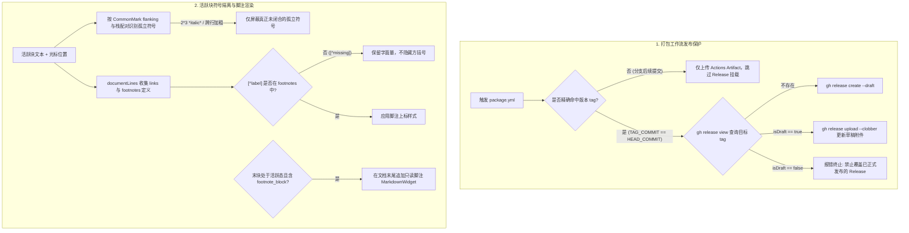

# 设计文档：复测六项问题修复

- 日期：2026-11-22
- 状态：草稿

## 1. 需求理解

针对本轮全量复测在 `main`（`5ac94ed`）与 `Inkstone.app 0.1.3` 实测中发现的 6 类实锤问题进行收敛修复：保护 `.github/workflows/package.yml` 不覆盖已正式发布的 Release、为 `electron/store.cjs` 保存时缺失父目录补充中文提示并修复 `test/desktop.mjs` 第 77 步漏建目录的超时问题、修复 `733ff6c` 引入的 3 处活跃块语法/脚注缺陷与 CJK 代理对边界问题、将纯前端包迁出 `package.json` 的 `dependencies` 以消除约 178 MB 冗余打包体积、修正 `src/styles.css` 多行引用竖线断口与混排列表对齐、同步 `README.md` 与 `package.json` 版本信息。本次严格遵守优先复用、保持整洁、拒绝过度设计与测试克制原则，只写设计文档，不实施代码改动。

**关键假设与待确认事项**：
- 假设一：`package.json` 的 `version` 字段保持与最新已发布版本基线一致或按发版节奏更新，CI 打包仍以 git tag 为准。
- 假设二：保留 `DocumentStore.save()`“不静默创建不存在父目录”的数据安全边界（与 `test/store.test.js` 既有断言一致），仅改善错误文案。
- 待确认事项：后续若需要从非 tag 提交测试打包产物，确认仅上传 Actions Artifact、不挂载任何 Release 即满足需求。

### 文档与代码差异

1. **打包工作流是否创建 Release 不一致**
   - 冲突位置：`README.md`「打包」章节（第 84–93 行）与 `.github/workflows/package.yml`（第 184–230 行 `draft-release` 作业）。
   - 具体差异：`README.md` 仍声明“在 GitHub Actions 里手动打包，不创建 Release”；实际代码中的 `package.yml` 已在打包后自动下载产物并创建/更新对应 tag 的 Release（且未校验 `isDraft`）。
   - 来源提交：`5ac94ed2a3f0f2d5c3afe607bed72a800bf31120`（作者 `shenziggy0`，日期 `2026-11-21 13:46:09 +0800`，摘要 `打包工作流自动将双平台安装包挂载到 Release 草稿`），该提交在 `package.yml` 新增 `draft-release` 作业但未同步更新 `README.md`。
   - 类型：**文档过期**。

2. **版本与 GitHub Release 状态描述过期**
   - 冲突位置：`README.md`「当前进度」章节（第 27 行）与仓库实际 Release/tag 状态及 `package.json`（第 3 行）。
   - 具体差异：`README.md` 仍写“版本 `0.1.0`，仓库里还没有 GitHub Release”；实际仓库已存在 `0.1.2`、`0.1.3` Release，而 `package.json` 仍保留 `"version": "0.1.0"`。
   - 来源提交：`6eac393fc888997aa75843a2f8cc2b495c0f7ffc`（作者 `Cursor Agent`，日期 `2026-11-14 14:29:48 +0000`，摘要 `feat: 添加 IN 应用图标并重写 README`）写入初始 `0.1.0` 说明，后续发布 `0.1.2`/`0.1.3` 后未回写 `README.md`。
   - 类型：**文档过期**。

## 2. 接口改动

无。本次不新增、修改或废弃任何 IPC 通道（`inkstone:*`）或外部 HTTP 接口，所有修复均在现有模块内部完成：

- **复用与最小扩展对象**：
  - `electron/store.cjs`：`DocumentStore.save()` 复用现有路径规范化与错误信封机制，仅对 `fs.realpath(path.dirname(requestedFile))` 的 `ENOENT` 异常映射为中文提示 `保存位置所在的文件夹不存在。`。
  - `src/live-preview.js`：合并重复的 `isolateUnclosedDelimiters` 与 `maskBlockLines` 扫描逻辑为同一套可复用辅助函数，不改变 `liveBlock(document, startLine, endLine, editingLines, caretLines)` 与 `documentLines(source)` 的对外函数签名（仅在 `documentLines` 返回对象增加 `footnotes` 集合字段）。
  - `src/editor.js`：`liveDecorations(state, id)` 复用 `MarkdownWidget` 挂载底部独立脚注区，不改变 `createEditor` 接口。

## 3. 数据库改动

无。本项目为本地优先桌面应用，不使用关系型或文档型数据库，无表、字段或索引变更。

## 4. 流程图

## 5. 范围边界

- **本次做**：
  1. `.github/workflows/package.yml`：增加精确 tag 校验输出与 `isDraft == false` 防覆盖保护。
  2. `electron/store.cjs`：捕获缺失父目录的 `ENOENT` 抛出中文提示；`test/desktop.mjs`：在 L2244 前补齐 `unsaved-save` 目录创建。
  3. `src/live-preview.js`、`src/md-syntax.js`、`electron/markdown-parser.mjs`、`src/editor.js`：合并并改用基于 CommonMark flanking 与栈配对的孤立分隔符屏蔽，修复 `2*3 *italic*` 与同行“行内+跨行加粗”；区分已定义/未定义脚注与脚注定义着色；修复末块活跃时底部脚注渲染区消失；修复 CJK 代理对字符截断。
  4. `package.json`：将 `@codemirror/*`、`@lezer/*`、`dompurify`、`highlight.js`、`mermaid` 移至 `devDependencies`，保留主进程必需的 `markdown-it*` 与 `katex` 在 `dependencies`，并同步 `version`。
  5. `src/styles.css`：修复 `.cm-prefix-quote` 多行断口与 `.cm-prefix-bullet` / `.cm-prefix-task` 混排左对齐。
  6. `README.md`：更新当前进度与打包/Release 说明。
  7. `test/live-preview.test.js`、`test/markdown.test.js`、`test/store.test.js`：补充针对上述缺陷的最小必要单元测试。

- **明确不做**：
  1. 不改用“可编辑渲染 DOM”替代现有 CodeMirror 活跃块装饰架构。
  2. 不在 `DocumentStore.save()` 中自动创建不存在的父目录。
  3. 不处理 Poppler / Pandoc 安装、Windows/Linux 实机、真实系统中文 IME 人工验证、Apple Developer ID 公证等环境外部事项。

## 6. 验收标准

- [ ] **发布工作流保护**：在 `.github/workflows/package.yml` 中，当 `TAG_COMMIT != HEAD_COMMIT` 时跳过 `draft-release` 挂载；当目标 tag 对应的 Release `isDraft == false` 时，`draft-release` 明确失败退出且不覆盖正式版附件。
- [ ] **保存报错与桌面端到端恢复**：`store.save(doc.id, path.join(root, 'missing', 'new.md'))` 拒绝保存并抛出含“文件夹不存在”的中文错误；`node test/desktop.mjs` 123 步完整通过，不再在 L2247 超时中断。
- [ ] **活跃块语法与脚注回归**：
  - `2*3 *italic*` 光标位于行尾时，`italic` 保留 `em` 样式且 `*` 正常配对隐藏。
  - `**第一行** 和 **跨行\n第二行**` 光标位于第一行时，两处加粗均保持 `strong` 样式。
  - `正文[^missing]结束` 保持字面量（无隐藏标记、无 `sup`/`link` 样式）；`[^fn1]: 脚注说明` 不把正文染成 `cm-lv-link`；光标停在最后一行时，底部已定义脚注区仍可见。
  - `𠀀**（测试）**𠀀` 在阅读态与活跃态均正确识别为加粗。
- [ ] **包体与视觉对齐**：`npm run build` 与 `npm test` 全部通过；打包检查确认主进程所需依赖完整且 `app.asar` 不再包含纯前端冗余 `node_modules`；`visual-check.mjs` 截图中多行引用竖线连续、混排列表圆点与复选框左边缘对齐。
- [ ] **文档一致性**：`README.md` 对当前版本、GitHub Releases 与 `package.yml` 行为的描述与仓库现状一致。

## 7. 影响面

- **主进程与构建打包**：`electron/store.cjs` 仅影响保存目标父目录不存在时的错误文案；`package.json` 依赖分层会直接缩小 Windows NSIS 与 macOS DMG 安装包体积，需通过本地构建或实际 `app.asar` 校验确认 `electron/markdown-parser.mjs` 所需的 `markdown-it*` 与 `katex` 仍在生产依赖树中。
- **编辑器排版与渲染**：`src/live-preview.js`、`src/md-syntax.js`、`src/editor.js` 的改动处于活跃块装饰核心路径，可能影响 `test/parity.test.js`、`test/live-preview.test.js`、`test/heading-preview.browser.js` 及 `test/perf.mjs` 的性能与一致性，实施后须完整复跑。
- **CI/CD**：`.github/workflows/package.yml` 改动仅作用于手动触发的 `package` 工作流，不影响日常 `push`/`pull_request` 触发的 `ci.yml`。

## 8. 回滚方案

- **代码与配置回滚**：本次所有修改均局限在单仓库普通提交内，不涉及数据格式升级或持久化迁移。若实施后发现排版回退或打包缺依赖，可直接 `git revert <commit>` 恢复对应文件并重新触发 `npm run build` / `package.yml`。
- **Release 资产恢复**：若 `0.1.3` Release 已被此前 Run `44872477136` 覆盖，在保护补丁合入后，可从历史精确 tag `0.1.3`（Run `44851904926`）重新核对或手动上传正确安装包，后续版本一律通过新 tag（如 `0.1.4`）发布。
- **触发回滚的条件**：`npm test`、`test/parity.test.js`、`node test/desktop.mjs` 任一核心步骤失败，或打包后主进程加载 `electron/markdown-parser.mjs` 出现 `ERR_MODULE_NOT_FOUND`。
