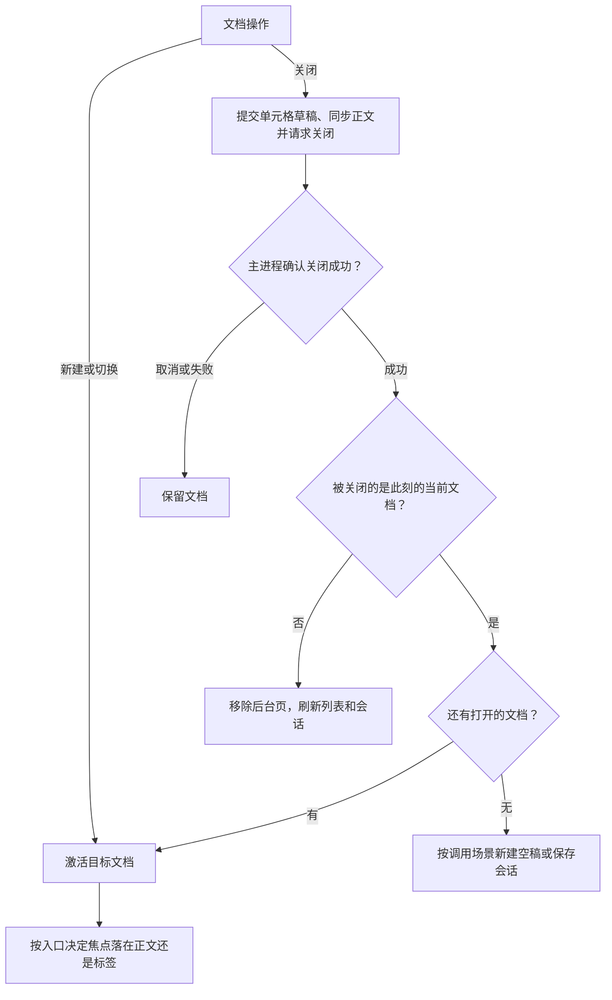

# 设计文档：写作区四项交互修复

- 日期：2026-11-24
- 状态：草稿

## 1. 需求理解

旧预览包中，点“新建”后焦点可能留在按钮上，换篇时又可能随旧编辑区的卸载而丢失。标题已变，立即打出的字却没有进入新稿。旧关闭流程每次都激活最后打开的文档，因此在甲稿上关闭后台的乙稿，会意外跳到丙稿。

在 1000 × 650 像素的工作台窗口中，旧状态栏压在编辑区最下面的 65 像素，部分可见文字点不到。侧栏则在启动时按布局类型强制展开，盖过了用户手动收起的选择。

- **关键假设**是新建、点选已打开的文稿和写作中换篇都表达继续输入的意图。使用方向键浏览标签时，用户仍需要操作标签。宽窗口的侧栏是布局偏好，窄窗口的抽屉是一次临时操作。
- 本 RFC 补录 `main` 工作树中已有的修复，供评审和回归使用。Apple 芯片 Mac 预览包已复测。**待确认项**为 Windows、Linux 实机上的对应交互。

### 文档与代码差异

1. **关闭接口的可选返回值。** 旧 RFC §2.1 只列出 `closeDocument(id)` 及布尔结果。主进程另支持 `includePath=true`，供退出流程收集最终文件路径。提交 `68e3364`（ziggy，2026-11-13，《修复一些已知问题》）同时加入了这行文档和可选参数。类型待确认。单参调用的描述成立，退出分支在该文档中缺失。[RFC 0001](0001-项目审查九项问题修复.md) · [主进程关闭处理](../../electron/main.cjs)
2. **旧版栏高的验收口径。** 第 10 轮交接记录和对等基准 §5.7 记录了 38 像素标题栏，交接记录还列出 24 像素的极简状态栏。提交 `19313868`（shenziggy0，2026-11-07，《UI: default Typora-like chrome, typography and pristine rendering》）同时写入旧样式与说明。`e47985b`（ziggy，2026-11-07，《fix: 全项目审计修复（第 1～6 批）》）把 38 像素写入 Windows 原生标题栏常量和回归映射 §5.4。当前 `electron/main.cjs` 的 `TITLE_BAR_HEIGHT` 为 64，`src/workspace.css` 的 `.statusbar` 随内容占行。新版差异的来源提交未查到，相关改动仍在工作树，类型待确认。本次按正文与状态栏的实际边界验收。[交接记录](../../HANDOFF.md) · [对等基准](../parity-baseline.md) · [回归映射](../regression-map.md)

## 2. 接口改动

**渲染进程内部**

| 路径与方法 | 入参、返回值与处理 |
| --- | --- |
| `src/main.js` · `addDocument(record, focusEditor?)`、`activate(id, focusEditor?)` | 新增可选布尔入参。前者返回 `Promise<void>`，后者返回 `void`。新建和鼠标点选已打开的文稿时显式请求正文焦点。菜单换篇省略参数，在旧编辑区卸载前读取焦点归属。需要继续写作时，在目标挂载后调用其 CodeMirror `view.focus()`。主编辑区处于 `inert` 或对话框打开时，焦点留给当前交互。 |
| `src/main.js` · `moveTabFocus(event)` | 沿用标签键盘入口。方向键、Home、End 激活对应标签后，在重绘的标签列表里聚焦选中项，使连续按键仍可浏览。 |
| `src/main.js` · `closeDocumentNow(doc, createReplacement, includePath)` | 签名和返回值沿用现有约定。先提交表格单元格草稿、同步正文，再等待主进程关闭确认。在确认返回时比较 `activeId` 和被关闭文档的 ID，避免等待期间用户已换篇。关闭后台页只刷新文档列表、侧栏和会话。关闭当前页才激活剩余文档中最后打开的一篇。 |

**进程间接口**

| IPC 方法 | 入参 | 成功结果与兼容性 |
| --- | --- | --- |
| `inkstone:settings` | 可选的偏好补丁，扩展一个布尔字段 `workbenchSidebarVisible` | 省略补丁时读取偏好，写入后返回完整偏好。沿用 `inkstone:bootstrap` 的 `preferences` 将有效值交给窗口。 |
| `inkstone:closeDocument` | `id`、可选的 `includePath=false` | 普通关闭返回 `true`，用户取消返回 `false`。请求路径且关闭成功时返回 `{ path }`，未命名文档的路径可为 `null`。 |

沿用 preload 转发和主进程现有的 `{ ok: true, value }`、`{ ok: false, error }` 信封。取消或保存失败时，渲染层保留文档。本次无新增 HTTP 路由、IPC 通道或错误码。[桌面桥接](../../electron/preload.cjs) · [主进程处理](../../electron/main.cjs)

## 3. 数据库改动

无。偏好存放在 Electron 用户数据目录的 `settings.json`，继续通过现有偏好接口原子写入。数据库表、索引和回滚 DDL 均不涉及。

快速切换侧栏时，多次原子写入也可能乱序完成。主进程把每次写入的完整偏好快照加入同一队列，侧栏、窗口位置和缩放共用该队列。正常退出会等待已提交的写入完成。

| 布局 | 持久化字段 | 首次使用的默认值 |
| --- | --- | --- |
| 简洁写作（`typora`） | 既有 `sidebarVisible` | `false`，收起 |
| 完整工作台（`workbench`） | 新增 `workbenchSidebarVisible` | `true`，展开 |

旧版只有一个开关，无法表达两种布局的不同选择。启动时优先读取布尔型新字段。若缺少有效新字段，且旧设置同时为 `uiMode="workbench"` 和 `sidebarVisible=false`，工作台继承收起状态，其余情况采用展开。简洁写作继续使用旧字段。宽度不超过 760 CSS 像素时，开合抽屉只更新窗口内的 `compactSidebarOpen`。浏览器开发预览采用相同默认值，重启持久化以 Electron 为验收入口。[偏好读取](../../electron/main.cjs) · [布局切换](../../src/main.js) · [浏览器预览](../../src/browser.js)

## 4. 流程图

## 5. 范围边界

- **覆盖范围**为单窗口的写作焦点、后台页关闭、底部状态栏占位，以及两种布局的侧栏记忆。文件保存、冲突处理和退出确认继续使用已有流程。
- **范围外**为 Markdown 语法、正文配图、导出格式、界面主题重设计及安装发布。欢迎文档仍直接从标题开始。
- **后续维护**先对照仓库文档、调用方与真实源码。复用 `activate`、`documentOperation`、CodeMirror 和既有偏好对象，分别由渲染层、CSS 和主进程负责焦点、布局和持久化。每个新增字段只表达现有字段无法保存的选择。回归用例围绕第 6 节的真实写作路径组织。

## 6. 验收标准

使用独立的桌面测试配置目录和三个真实 Markdown 文件。可先执行 `npm run build`，再执行 `node test/workspace.desktop.mjs`。[专项桌面用例](../../test/workspace.desktop.mjs)

- [ ] 点“新建”后直接打字，文字出现在新稿中。用鼠标点乙稿标签，或在甲稿中执行“下一个文档”切到乙稿，直接输入并保存后，乙稿磁盘内容含新增文字，甲稿字节与操作前一致。用方向键或 Home 浏览标签，焦点留在所选标签上。
- [ ] 依次打开甲、乙、丙并回到甲，关闭后台乙稿后，乙从列表移除，甲仍为当前文档且可继续输入。对有未保存更改的后台稿选择“取消”时，两篇文档及当前选择均保留。
- [ ] 在 1000 × 650 和 736 × 620 的窗口滚动长文。编辑区下边缘不超过状态栏上边缘（自动比较允许 1 CSS 像素舍入差），点击可见正文字符能定位光标。状态栏按钮仍可操作。
- [ ] 在宽窗口分别展开简洁写作侧栏、收起工作台侧栏，重启并切换布局，各自恢复所选状态。连续开合工作台侧栏后，磁盘配置和重启界面都采用最后一次选择。窄窗抽屉的开合独立于这两项偏好。用仅含旧开关的 `{"uiMode":"workbench","sidebarVisible":false}` 启动，工作台应收起侧栏。

## 7. 影响面

- **编辑与导航**共用一份 `activeId`。切换文档时先提交离开页面的单元格草稿，仅在目标编辑器尚未挂载时替换节点。关闭后台页时保留当前编辑器实例、选区和当前会话路径。若关闭按钮消失后焦点落到页面根部，鼠标操作将焦点交还正文，键盘或抽屉操作将焦点交给列表当前项。[文档激活与关闭](../../src/main.js)
- **正文与状态栏**是同一纵向 Flex 容器中的相邻元素。`#editor-host` 使用剩余高度并在内部滚动，`.statusbar` 独立占行，随控件高度适配窗口。代价是正文视口少一行工具的高度，换来可见文字均可点选。原先为悬浮状态栏预留的 64 像素滚动补偿随之移除，打字机模式仍保留自己的上下留白。[窗口结构](../../src/workspace.js) · [工作区样式](../../src/workspace.css) · [编辑区样式](../../src/styles.css)
- **持久化与权限**仅涉及一个布尔偏好。正文、附件和会话文件格式继续沿用。现有主进程校验和文件访问权限足以承载本次变更。

## 8. 回滚方案

1. 若输入落入错误文件、取消关闭后文档消失，优先回退 `src/main.js` 中激活、关闭及相关入口的改动。若出现正文底部遮挡或滚动异常，将状态栏布局与对应的 CodeMirror 滚动补偿配套回退。按变更块恢复，保留同一工作树里独立的界面改动。
2. 若旧配置启动或侧栏恢复异常，成对回退渲染层字段选择与主进程偏好读取，并对齐浏览器预览默认值。降级可保留新增布尔键，旧界面继续读取 `sidebarVisible`。旧工作台可能再次默认展开。用户文稿、会话和其他偏好均无需清理或迁移。
3. 回退后重新构建，在隔离配置目录用同一组甲、乙、丙文稿复核实际写入文件、取消关闭及底栏点击位置，再决定是否替换本地预览包。
