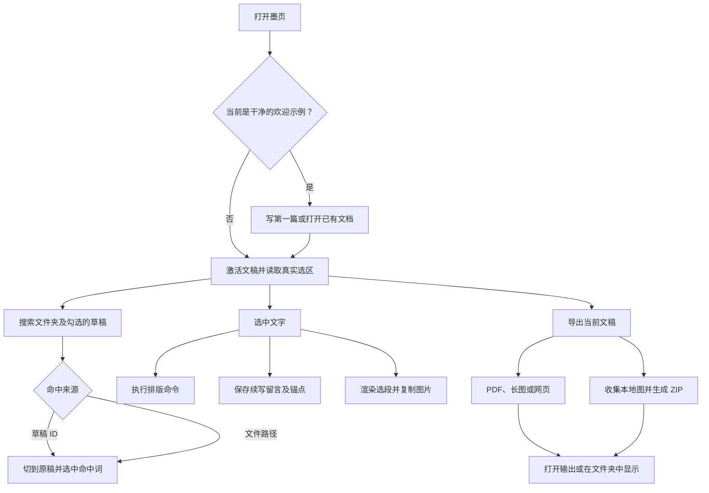

# 设计文档：草稿找回与写作分享

- RFC 编号：0005
- 日期：2026-11-24
- 状态：草稿
- 设计基线：Inkstone `main`，`c116b15` 及当前工作区的界面改动。

## 1. 需求理解

第一次用墨页写两篇手记，即使正文已有标题，两份草稿仍显示为「未命名.md」；在「文章」里点不开，在文件夹搜索里也找不到。用户应能先写，靠标题或记得的一句话找回草稿。
从搜索结果选中文字后新建空稿，状态栏会沿用上一篇的行列和选中字数。切稿时应立即显示当前稿件的真实状态。
欢迎页应能直接开始写作，简洁布局应支持就地排版，导出常用格式应少做选择。三个新增用途是给自己留续写提示、把一段文字复制成图片、将可编辑原稿连同本地图片交给别人。

- **关键假设**　草稿搜索默认覆盖当前窗口。留言属于作者本人，仅存本机。分享操作使用点击时的文稿版本，文件名最终由用户确认。
- **待确认事项**　无阻塞项。macOS、Windows 的文件对话框、图片剪贴板和系统打开行为列入实机验收。

现状依据见 [README 的功能与导出说明](../../README.md)、[RFC 0003 的文档激活与焦点约定](0003-写作区四项交互修复.md)。当前文章列表在构造无路径条目时丢掉了已有的文档 ID；搜索只把有路径文件的未保存内容带入匹配；文档激活刷新了字数，但行列和选区显示依赖下一次编辑事件。对应实现见[侧栏、搜索和文档激活](../../src/main.js)。

## 2. 接口改动

### 草稿与写作界面

| 入口 | 拟议行为及调用约定 |
| --- | --- |
| 草稿展示与首次保存 | 在[文档界面](../../src/main.js)复用[已有标题解析](../../src/markdown.js)。取第一个一级标题，其次取首个非空正文行，忽略文档属性、代码围栏等语法；无正文时用「未命名」。保留欢迎示例和导入、恢复稿已有的显式名称或恢复标记。列表、标签、窗口标题和关闭提示使用同一建议名；同名草稿以窗口内稳定序号区分，操作始终按 ID。可给现有 `updateDocument(id, content)` 加可选建议名，供主进程 `selectSave(doc)` 使用；旧调用仍回退到 `doc.name`。主进程按单个合法文件名处理建议，复用现有文件名校验并保留系统重名确认。已有磁盘文件按真实文件名显示。 |
| 文章列表与全文搜索 | 无路径条目保留 `doc.id`，点击调用 `activate(id)`。现有 `searchFolder(query, options)` 增加可选草稿列表，元素含本窗口的文档 ID、显示名和最新正文；界面按默认开启的「包含本窗口草稿」传入，未传时仍只搜文件夹。主进程核对 ID 归属，复用 `buildMatcher`、`searchText`、取消机制和总结果上限。磁盘命中保留 `path`，草稿命中使用 `documentId`，共用行列、片段与高亮。无文件夹时也能只搜草稿。点中已关闭的稿件时刷新结果。首次保存后刷新搜索；没有工作目录时沿用打开文档的父目录接管逻辑，有目录时遵守其搜索范围。见[搜索实现](../../electron/search.cjs)和[文件夹与保存接口](../../electron/main.cjs)。 |
| 切稿状态与浮条 | 从 `selectionChanged()` 抽出读取编辑状态的函数，`activate()` 挂载目标编辑器后也调用它。滚动居中仍由实际选区变化触发。简洁布局中选区稳定后显示「粗体」「链接」「标题」，复用 `runCommand()` 和[已有排版命令](../../src/editor.js)。打开链接输入框时保留文档 ID 和选区；若期间换稿则取消操作。按 Esc、取消选择、切稿即收起。表格单元格编辑和输入法组字期间保持原有交互。 |
| 欢迎页 | 只在当前文档是未改动的内置示例时，在正文外显示「写第一篇」「打开已有文档」。复用已有新建和打开命令；创建或打开成功后替换干净的欢迎示例，取消打开则留在原页。按钮不进入用户正文、撤销历史或导出。见[欢迎示例](../../src/welcome.js)和[工作台结构](../../src/workspace.js)。 |

### 导出、图片与留言

下列名称为拟议的 Electron 内部 IPC，沿用[主进程](../../electron/main.cjs)及[预加载白名单](../../electron/preload.cjs)。成功沿用 `{ok:true,value}`，失败沿用 `{ok:false,error}` 和可显示的中文原因；取消保存返回 `null`。无新增 HTTP 接口或数字错误码。

| 方法与输入 | 输出、复用点与异常处理 |
| --- | --- |
| `exportDocument(id, format, payload)`，调整入口 | 首层提供 PDF、长图、网页；PDF 主按钮沿用当前配置直接选择保存位置，「PDF 设置」再展开预设和页码。「更多格式」容纳无样式 HTML、Pandoc 格式和原稿打包。沿用原返回值（输出路径或 `null`）及成功后才记忆配置的行为。成功提示提供「打开文件」「在文件夹中显示」。拟新增 `exportResultAction(path, action) → boolean`，只接受本窗口刚完成且仍对应可见提示的输出，打开前校验文件类型；文件已移走则提示。现有 `revealPath` 只接受工作区内路径，不能直接承担任意导出目录的定位。 |
| `copySelectionImage(id, {html, width}) → true`，新增 | 渲染层先固定文档、正文和非空选区，用[整篇解析上下文](../../src/markdown.js)得到选段及其引用定义、图片根目录；跨段选择保留段落排版，首尾段按实际选择截取。图表和图片按完整对象呈现。不调用空选区会回退全文的 `selectedText()`。沿用 [PNG 页面构造](../../src/export.js)、资源内嵌、隐藏窗口 `capturePng()` 和已有系统图片剪贴板写入。此操作无需文件保存窗口。超出截图尺寸或渲染失败时提示，保留原剪贴板内容。 |
| `listWritingNotes(id) → 留言列表`、`updateWritingNote(id, change) → 更新后的留言`，新增 | 选一句文字可「留个续写提示」。`change` 表达新增、修改文字、重新定位或标记完成；每次只改一条。大纲旁列出本稿留言，点击后复用编辑器定位。旧会话和历史记录只有文稿或版本，缺少留言正文与选区锚点，因此需新增本地元数据。原文已删除或有多个候选时保留留言并显示「需重新定位」，由用户选择新位置。 |
| `exportDocument(id, 'zip', payload) → 输出路径或 null`，扩展格式 | 点击时先提交当前可提交的单元格编辑并同步文稿，主进程固定正文与图片解析基准。扩展[图片引用收集与重写](../../electron/asset-references.mjs)，使打包能枚举有效的本地图片引用；现有保存迁移继续使用原来的 `assets/` 筛选。通过[图片解析器](../../electron/assets.cjs)处理普通相对引用、引用式图片、图片根目录及草稿临时图片。同一来源只打包一次，不同来源同名时分配不同包内名，只改副本引用，保留 BOM、换行和其他正文。清除副本中已失效的[本机图片根目录设置](../../electron/front-matter.mjs)。远程引用保留网址。遇到不可读图片先列出引用，用户选择取消或接受缺图继续。现有直接运行依赖未提供 ZIP 写入，实施时引入一个跨平台运行时 ZIP 库，以目标目录临时文件生成，成功后替换目标。 |

## 3. 数据库改动

无。墨页沿用本地文件存储，无建表、索引迁移和回滚 DDL。仅续写留言需要新增持久化。

- **已保存文稿**　拟在 `userData/writing-notes/` 按文稿保存一份带版本的 JSON，仅有留言时创建。复用文档规范路径与 `historyKey()` 的计算规则，使用独立目录，避免历史清理误删留言。每条包含留言 ID、文字、完成状态，以及选区的起止偏移、原文和短前后文。偏移使用编辑器归一化后的 LF 文本坐标。见[文档存储与原子写入](../../electron/store.cjs)。
- **未保存草稿**　把留言作为可选字段随既有恢复记录写入。旧记录缺字段即空列表。`recoverAll()` 会创建新的文档 ID，因此恢复时随正文转交留言，并在新记录写好后再退役旧记录。首次保存将留言写入目标文稿键后再清理恢复副本，按留言 ID 合并以支持重试。
- **路径与锚点变化**　应用内改名或移动时迁移键；另存为给新文件复制留言，原文件保留原记录。不同窗口修改同一文稿时按文件键串行合并单条操作并原子落盘。文内编辑用 CodeMirror 的变更映射移动锚点；重开或外部改稿后用原文和前后文校验，只接受唯一匹配。留言操作不改变 Markdown 的已保存状态，导出不夹带私人留言。

## 4. 流程图

## 5. 范围边界

| 交付顺序 | 包含的工作 |
| --- | --- |
| 第一批 · 找回草稿 | 草稿可辨认、可点开、可搜索；首次保存建议名；激活文档时同步选区状态。可独立发布。 |
| 第二批 · 开始写与导出 | 欢迎页首屏入口、简洁模式选区排版、导出面板分层及结果操作。保留完整工作台、原有导出格式和 PDF 预设。 |
| 第三批 · 继续写与分享 | 作者本机的续写留言、选区图片剪贴板、单篇 Markdown 连本地图打包。 |

本次不做账号、云同步、多人批注、跨窗口草稿索引、外部改名追踪和整库归档。压缩包只收录这篇文稿实际引用的本地图片。跨文档链接仍是链接，网络图片需要联网查看。桌面系统能力以真实 Electron 为准，浏览器预览沿用现有可用格式。

## 6. 验收标准

- [ ] **首开与草稿。** 用空配置从欢迎页点「打开已有文档」再取消，示例仍在；点「写第一篇」新建《行李清单》和《想去的地方》。两份草稿在标签与文章列表可辨认、可切换。未打开文件夹时搜「望远镜」可命中并选中原句；取消「包含本窗口草稿」后该命中消失。首次保存建议 `行李清单.md`，保存至搜索目录后只剩一个文件命中。改正文标题不会改磁盘文件名。
- [ ] **切稿状态。** 在完整工作台选中旧稿第 9 行的「小林」，新建空稿应显示第 1 行第 1 列、0 字符且无选中字数。切回旧稿应显示原选区，后台文档的更新不会覆盖它。
- [ ] **排版浮条。** 在简洁布局中选中文本，分别加粗、插入链接、设置标题，结果写入原选区或所在段落，可撤销。按 Esc 或切稿后浮条关闭；中文输入法组字、单元格编辑期间不抢焦点。
- [ ] **普通导出。** 首层可直接导出含中文标题的 PDF，打开文件及显示所在目录两项操作在工作区外也指向本次产物。展开后可沿用旧 PDF 预设；取消导出不提示成功。未安装 Pandoc 时仍可用 PDF、长图、网页，在更多格式内能看见依赖说明。
- [ ] **续写留言。** 留下「下次查潮汐时间」，在选段前增写、保存并重开后仍能定位，标记完成后重开仍为完成。原句删除时提示重新定位。未命名稿在崩溃恢复及首次保存后仍只出现原有的一条留言。
- [ ] **选区图片。** 选中含一张引用式本地图片的小节，定义放在选区外；复制后在另一应用粘贴，图片包含所选段落与插图，前后未选章节和工具栏均不出现。空选区不能触发整篇复制。
- [ ] **可携带原稿。** 用两份同名不同图、引用式图片、图片根目录和一张缺图制作手记。取消缺图提示时原目标完好；选择继续后，解压到另一目录，在无法访问原图片目录的条件下打开，已打包图片均能离线显示。同一图片多次引用只入包一次，原 Markdown 与原图字节保持一致。未命名稿插入的临时图也须能打包。
- [ ] **平台验收。** 在 macOS、Windows 的真实 Electron 上核对原生首次保存、导出后打开、跨应用粘贴图片和异地解压。优先扩展[工作台](../../test/workspace.desktop.mjs)、[首次保存](../../test/rfc0001-first-save.mjs)、[搜索](../../test/search.test.js)、[存储](../../test/store.test.js)和[桌面导出](../../test/export.desktop.mjs)现有测试；系统交互使用实际文件和剪贴板。

## 7. 影响面

- **编辑与导航。** 两种布局共用文档身份和编辑命令。草稿名变化只更新相关导航文字，复用已解析的标题；编辑器、选区及撤销栈保持原实例。搜索复用当前防抖、过期请求丢弃及命中上限，草稿内容只在当前窗口和其主进程上下文中匹配。
- **存储与隐私。** 只有留言增加本机元数据。首次保存、改名、另存及恢复涉及文稿和留言两个写入时点；次要写入失败时应说明哪部分已保存，并保留可重试的原留言。附件读取沿用现有真实路径、可读图片类型和目录规则。包内条目使用生成的相对名称。
- **导出与维护。** 选区图片与整篇 PNG 共用离线截图、主题、尺寸限制。ZIP 依赖进入桌面发行包。实施前逐项对照 README、现有调用方和代码，优先最小扩展；仅新增现有方式无法承载的留言存储、选区复制与产物操作。接口按文档 ID 或确切输出寻址，避免重复状态、平行渲染器和通用插件层。测试集中覆盖上述用户操作链。

## 8. 回滚方案

- **草稿或切稿回归。** 若出现打开错稿、重复结果或状态串稿，分别回退本批的导航、搜索或状态投影改动。新增搜索选项和建议名均可省略，旧版仍能从原有路径和恢复记录打开文稿。
- **写作与普通导出回归。** 若浮条抢输入、欢迎操作影响正文或新面板无法正常输出，退回对应界面入口，恢复原排版命令和导出面板。原有 PDF 预设继续使用，无需清理用户配置。
- **留言归属或迁移异常。** 优先停止受影响的留言写入和迁移，保留已有 JSON、恢复记录与原文，待修正后按留言 ID 重试。降级前为带留言的未保存草稿保留恢复记录副本；旧版重写恢复记录可能丢弃陌生字段。已保存文稿的留言仍保存在应用数据目录中。
- **分享结果有误。** 若选区包含额外正文，撤回选区复制入口，保留整篇 PNG。若 ZIP 缺失已确认可读的图片或改动原稿，撤回打包入口与该格式处理。已成功导出的文件继续归用户所有；失败操作只清理本次产生的临时文件。
