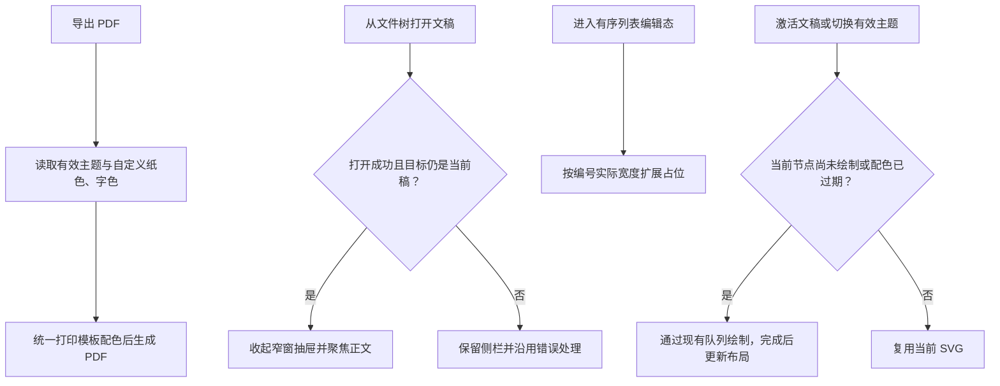

# 设计文档：导出与编辑四项缺陷修复

- 日期：2026-11-25
- 状态：草稿

## 1. 需求理解

- 深色或跟随系统深色时，PDF 正文用了浅色字，纸面却是白色。导出应采用同一主题下成对的纸色和字色。
- 从文件树打开文稿后，下一次输入应直接进入该稿正文。宽窗保留文件树，窄窗收起抽屉再交还焦点。
- 普通有序列表的长编号在点入正文或编辑编号时应完整可见。一、两位编号继续遵循 RFC 0004 的位置和折行验收。
- 批量打开文稿后，切回后台页应显示图表。若后台期间切换了主题，图表应采用切回时的配色。
- **关键假设**　PDF 沿用导出时的有效主题。**待确认**　复现证据来自 macOS，Windows、Linux 的打印和焦点表现以实施后实机结果为准。

### 文档与代码差异

- [README 简介](../../README.md#墨页--inkstone)描述打开文档后能看到排好版的阅读视图。实际批量打开时，[图表队列](../../src/markdown.js#L847)跳过了已卸载的节点，而[文稿激活](../../src/main.js#L891)没有补绘，切回第一篇仍可见图表源码。源头是 `3ba09be`（shenziggy0，2026-11-07，初次提交 Inkstone 0.1.0），引入控件创建时排队及跳过脱离页面节点的逻辑。`e47985b`（ziggy，2026-11-07，全项目审计修复第 1～6 批）写入整篇阅读视图的描述，`6eac393`（Cursor Agent，2026-11-14，添加 IN 应用图标并重写 README）改写并保留了该描述。`c116b15`（shenziggy0，2026-11-24，重做写作界面，修复编辑交互并对齐 Typora 重复标题链接）加入跟随系统，主题刷新仍只遍历当前页面。类型为「待实施设计」，记录为功能描述中的覆盖缺口。

## 2. 接口改动

**PDF 纸色和字色**

- [`printHTML(title, body, css, options)`](../../src/export.js#L25)沿用现有签名和 HTML 字符串返回值。打印页复用传入的有效主题，纸色回退到 `--color-paper`，字色回退到 `--color-ink`，并分别优先采用自定义主题已有的 `--inkstone-theme-paper` 和 `--inkstone-theme-ink`。打印模板和 `.print-document` 使用同一对颜色变量，消除页背景与正文各取一套规则的情况。打印颜色控制放在独立 PDF 模板内，以实际生成的 PDF 检查正文区域的背景。
- [导出流程](../../src/main.js#L1509)继续传有效主题值。Electron 沿用[现有打印选项](../../electron/export-settings.cjs#L138)和隐藏窗口。页眉、页脚由独立模板生成，用同一份 PDF 验证其与页边距背景的对比度。

**从文件树打开后继续写作**

- [`openDocuments(records)`](../../src/main.js#L861)继续接受单条、数组或空值，返回值改为 `Promise<string | null>`，即本次最后打开并激活的文档 ID，或无结果时的 `null`。调用方可忽略返回值。沿用欢迎页替换、文稿激活和工作目录同步。
- [文件树点击入口](../../src/main.js#L2016)使用同一个 `openDocument(path)` IPC。成功返回文档 ID 后，确认它仍是当前稿，收起窄窗抽屉，再复用 `activate()` 中的焦点判断，把焦点交给目标 CodeMirror。将该判断提取成小的内部函数，供两处共用。空结果或读取失败时保留侧栏状态，沿用原有错误提示。按 Escape 关闭抽屉仍回到侧栏按钮。

**长编号显示**

- [`src/styles.css`](../../src/styles.css#L119)中，`.cm-prefix-ordered` 和 `.cm-ordered-source` 共用的 `--ordered-gutter` 作为最小宽度。编号占位宽度按文本和内边距自然增长，超出最小宽度时向正文方向扩展，保住编号首位。短编号沿用现有悬挂缩进，两种编辑状态继续使用同一组盒模型规则。长编号可多占首行宽度，折行时正文按现有列表缩进对齐。
- 沿用 [`PrefixWidget` 和现有编号装饰](../../src/editor.js#L796)、`ol/li` 语义及源码位置映射。实现先验证 CSS 的固有尺寸在 CodeMirror 生成的两种 DOM 上都有效。

**后台图表补绘与主题更新**

- [`renderDiagrams(container)`](../../src/markdown.js#L847)保留 `Promise<void>`。扩展现有队列，在真正处理节点时检查它仍属于当前容器、已接入页面，且尚未完成当前主题的绘制。复用节点已有的源码和完成状态，另外记录其实际使用的主题。有效主题未变时保留已完成的 SVG，首次跳过的节点留待下次挂载。
- [`refreshDiagrams(root, themeKey)`](../../src/markdown.js#L889)新增有效主题标识参数，并继续返回 `Promise<void>`。由现有唯一的主题刷新调用方 `applyPreferences()` 传入已解析的浅色、深色、纸张或自定义主题标识。在对应 CSS 生效后采样配色，较早的自定义主题读取结果沿用现有的请求序号判断。激活稿件并设置源码或排版模式后，对当前挂载树调用 `renderDiagrams()`。异步 Mermaid 完成时再次检查节点归属和主题，避免卸载后的节点被写回或较旧配色覆盖新结果。渲染完成且编辑器仍显示该稿时，用已有的 `requestMeasure()` 更新布局。[主题偏好处理](../../src/main.js#L1134)
- 图表语法错误继续显示源码和现有错误消息。编辑预览、正文、选区图片与导出继续使用同一渲染器和清理规则。主进程 IPC、返回信封和错误码无改动。

## 3. 数据库改动

无。焦点和图表绘制状态只存在于当前窗口。Markdown 文件、偏好设置、PDF 预设和会话格式无需迁移。

## 4. 流程图

## 5. 范围边界

- 改动落在桌面 PDF 模板、文件树打开入口、普通有序列表编辑态和已挂载的图表。编号验收覆盖普通 Markdown 列表，嵌套、引用和任务列表沿用各自排版规则。
- RFC 0005 的导出面板与选区图片会经过现有打印或图表入口，实施时以当前工作树为准对接。[RFC 0005](0005-草稿找回与写作分享.md)

## 6. 验收标准

- [ ] 用正式导出入口对同一份含中文标题、正文和页码的文档生成浅色、深色和跟随系统深色 PDF。将实际 PDF 栅格化，正文文字与相邻纸面的对比度至少为 4.5:1，深色两组保持深纸浅字。启用页眉页脚后仍可辨认，标题书签、文本回读和预设通过现有导出专项。[导出专项](../../test/export.desktop.mjs)
- [ ] 在 1050 和 736 CSS 像素宽的窗口中从文件树打开真实 `.md` 文稿，随后直接输入并保存。新增字只出现在目标文件，宽窗侧栏可见，窄窗抽屉收起。另用 Escape 收起抽屉，焦点回到侧栏按钮。[工作台专项](../../test/workspace.desktop.mjs)
- [ ] 在 910 CSS 像素宽的窗口中打开以 `123456789.` 起始的普通列表，点正文、进入编号、修改一位数字并保存。两种编辑状态的编号文字均位于编辑区可见边界内，磁盘只出现预期的数字改动。运行现有 12 项列表用例，短编号的正文位置、折行和滚动通过原有阈值。[编号列表专项](../../test/ordered-list-layout.desktop.mjs)
- [ ] 批量打开含时序图、流程图和 Mermaid 的甲稿与普通乙稿。首次切回甲稿时三种图表都显示 SVG。在乙稿中将系统配色设为深色，再切回甲稿，SVG 对应深色主题，切换过程中不必进入源码模式。主题相同的再次切换复用已绘制的 SVG。保留现有图表错误提示与 PDF 图表回归。[图表专项](../../test/diagrams.desktop.mjs)

## 7. 影响面

- PDF 只在打印模板消费主题配色和既有自定义变量。现有文件选择、资源内嵌、隔离窗口和 PDF 预设仍是导出链的依赖。
- 焦点与状态栏共用当前文档 ID。焦点交还应复用文稿激活中的有效性检查，并保留激活时已有的选区和行列刷新。编号样式只作用在列表前缀，其实际宽度由浏览器布局计算。
- 图表仅对已挂载的待绘节点工作，继续复用 SVG 和串行 Mermaid 队列。导出与选区图片等待同一个渲染入口完成，现有 SVG 清理与离线资源约束仍适用。
- 实施先核对相关设计、调用方和源码，优先在现有函数内解决。仅在调用方确实需要时新增内部返回值或共享判断。按职责控制改动范围，将回归用例补到现有桌面专项。

## 8. 回滚方案

实施顺序为 PDF、文件树焦点、编号栏、后台图表，按四个改动独立回退。PDF 出现正文或页眉页脚的对比度回归时回退打印模板，受影响的 PDF 需要重新导出。出现焦点抢占时回退文件打开入口的焦点交还和相应返回值。短列表再次跳动或编号无法编辑时回退这次宽度规则，保留 RFC 0004 原有样式。图表出现重复绘制、配色乱序或导出漏图时，同步回退挂载触发和按主题判定的队列改动。四项均无需数据回滚或新增开关。
