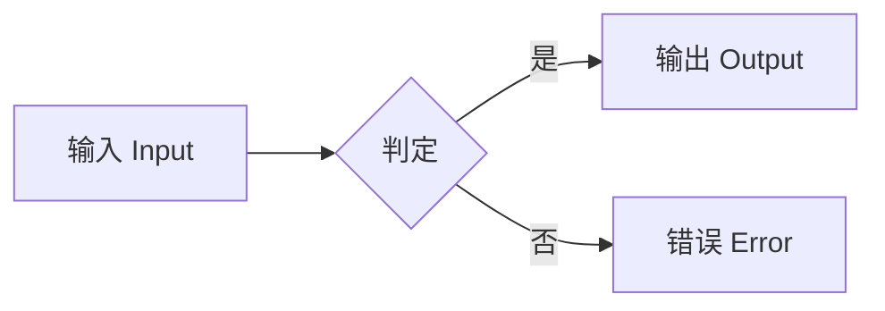
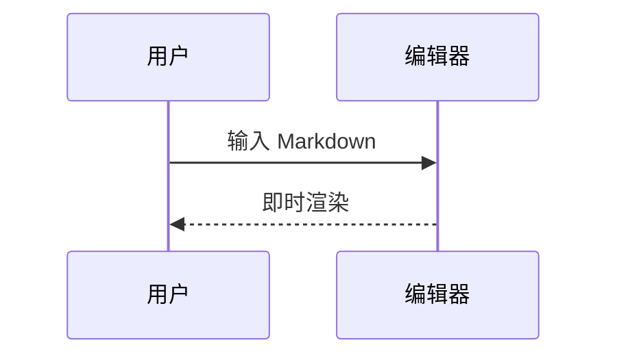

<!--
冻结回归语料 v0.1。内容改写自 CommonMark 0.31.2、GFM 0.29、
Typora Markdown Reference、KaTeX 与 Mermaid 官方示例；两平台必须使用同一份文件。
修改本文件即视为更新基准，需同步更新 docs/parity-baseline.md。
-->

[TOC]

# 一级标题 Heading One

中文与 English 混排，**加粗 bold**、*斜体 italic*、~~删除线 strike~~、`行内代码 code`、
==高亮 mark==、H~2~O、x^2^、:smile: 与转义 \*星号\*。

中文**紧贴加粗**中文（CJK 边界用例，见基准 §2.3）。

## 链接 Links

[行内链接](https://example.com/ "标题")、[引用式链接][ref-id]、<https://example.com/autolink>
以及 [跳转到二级标题](#链接-links)。

[ref-id]: https://example.com/reference "Reference title"

## 脚注 Footnotes

正文引用脚注[^fn1] 与第二个脚注[^fn2]。

[^fn1]: 第一个脚注含 *斜体* 与 **加粗**。
[^fn2]: 第二个脚注含 `代码`。

## 二级标题 Heading One

重复标题用于验证锚点编号（见基准 §2.1）。

# 一级标题 Heading One

第三个同名标题。

> 引用块 paragraph one。
>
> 引用块 paragraph two，含 **加粗**。

> [!NOTE]
> GitHub 风格警示块（见基准 §2.13）。

---

1. 有序项一
2. 有序项二
   - 嵌套无序项
   - 另一个嵌套项

- [ ] 待办事项一
- [x] 已完成事项二
- [ ] 待办事项三，含 `行内代码`

| 左对齐 | 居中 | 右对齐 |
| :----- | :--: | -----: |
| 中文 | some wordy text | ¥1600 |
| zebra | stripes | $1 |

```typescript
interface Parity {
  title: string;
  tags: string[];
}
const sample: Parity = { title: '中文标题', tags: ['md', 'math'] };
```

```python
def parity(items):
    return [item for item in items if item]
```

行内公式 $E = mc^2$ 与块公式：

$$
\int_0^1 x^2 \, dx = \frac{1}{3}
$$






<div class="custom-block">HTML 块原样保留（CommonMark 用例）</div>

&nbsp; 实体与 &amp; 符号，以及行尾双空格硬换行  
下一行从此处开始。
